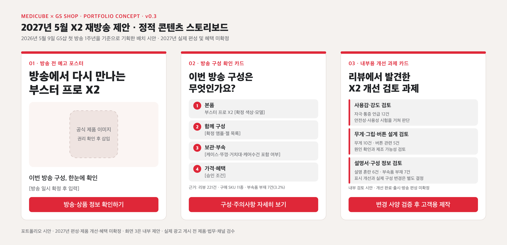

# GS샵 X2 2027년 5월 재방송 제안 · 정적 콘텐츠 스토리보드

> 포트폴리오 제작 초안 **v0.3** · 2026-11-21 · 영상 콘티가 아닌 **정적 소재와 제품 개선 제안의 읽는 순서·배치**
> **v0.3 변경 요약:** FAQ로 해결할 수 없는 사용 불편은 제품·구성·설명 방식의 개선 검토 대상으로 옮겼다. 화면 3은 내부용 개선 과제 시안이며, 실제 개선 완료·2027년 출시를 주장하지 않는다.
> **v0.2 변경 요약(직전 v0.1 대비):** GS샵 X2 리뷰 221건 전수 코딩 결과를 출처 키 E4로 연결하고, 화면 1에 방송·찬스쇼 계기 12건(5.4%) 근거와 연령 미표기 한계를 명시했다. 화면 2를 4항목(본품·함께 구성·보관·부속·가격·혜택)으로 나눴고, 화면 3을 리뷰에서 확인된 질문 3개(자극·버튼·설명서)로 전면 교체했으며, 화면 4에 체감 차이 중립 안내를 넣었다. 배치 시안 SVG·PNG도 같은 내용으로 다시 그렸다.

| 버전 | 최종 수정(KST) | 변경 요약 |
|---|---|---|
| v0.1 | 2026-11-21 09:58 | 방송 전 포스터·구성 확인 카드·사용 조건 FAQ·방송 후 확인 카드 4면 초안과 3면 배치 시안 |
| **v0.2** | **2026-11-21 10:16** | **GS샵 X2 리뷰 221건(E4) 근거 연결 · 화면 2 4항목 구조 · 화면 3 질문 3개 교체 · 화면 4 중립 안내 · SVG/PNG 재렌더링** |
| **v0.3** | **2026-11-21** | **화면 3을 내부용 개선 과제 카드로 전환 · 고객용 문구의 제품 변경·출시 확정 표현 금지** |

## 소재 공통 규칙

- **기획 타깃:** GS샵 X2 방송을 접했거나 다시 확인하려는 50대·60대 이상 잠재 고객. 실제 X2 구매 연령 분포는 미확인.
- **목적:** 리뷰의 사용 불편을 개선 검토 과제로 연결하고, 실제 변경이 승인되면 방송 내용과 상품 페이지의 동일 SKU 정보를 일치시킨다. 효능·구매 성과·시즌 수요를 주장하지 않는다.
- **출처 키:** E1 [GS리테일 2026-05-08 발표](https://www.newswire.co.kr/newsRead.php?no=1033994), E2 [GS샵 X2 핑크 찬스쇼 상품](https://m.gsshop.com/prd/prd.gs?mseq=event-beauty-booster-pro-x2&prdid=1117330943), E3 [GS샵 2026년 5월 X2 이벤트·방송 알림](https://event.gsshop.com/event/beauty/booster-pro-x2), E4 [GS샵 X2 리뷰 분석](메디큐브_GS샵_X2_리뷰분석.md)(GS샵 상품평 221건 전수, 2026-05-10~2026-11-10). E2의 후기·문의는 개별 사례이며 5060 전체 의견이 아니다.
- **E4의 한계:** GS샵 리뷰에는 작성자 연령이 표시되지 않는다. E4는 '5060 리뷰'가 아니라 'GS샵 X2 구매자 리뷰'이며, 본문에서 연령을 밝힌 3건(1.4%)은 자발적 언급일 뿐 분포가 아니다. 따라서 E4의 건수·비율은 **221건 표본 안의 코딩 결과**로만 쓰고, '5060 맞춤'·'5060에게 쉽다'·선물 구매 비중 같은 연령 주장의 근거로 쓰지 않는다.
- **개선판 경계:** 화면 3의 개선 항목은 내부 기획 가설이다. 제품 결함, 개선 완료, 새 SKU 출시, 5060용 설계, 2027년 편성을 확인된 사실처럼 쓰지 않는다. 변경 사양·안전·사용성 시험·제조·가격·방송 승인 전에는 고객에게 게시하지 않는다.
- **표현:** 제품 사진·GS 로고·방송 화면은 권리 확인 뒤 삽입. 날짜·시각·구성·혜택·가격은 2027년 승인된 정보만 사용. 제품 효과 전후 비교와 후기 문구의 인용은 별도 허락·심의를 거친다.

## 화면 1 · 방송 전 예고 포스터

| 영역 | 카피·배치 초안 | 근거·검수 |
|---|---|---|
| 상단 | 작은 브랜드명과 ‘GS샵 방송 제안 시안’ 워터마크 | 포트폴리오 표시. 실제 고객용 게시물에서는 승인된 GS·메디큐브 표기만 사용 |
| 메인 제목 | **“방송에서 다시 만나는 부스터 프로 X2”** | 2026년 첫 GS 방송 E1. E4에서 방송·찬스쇼를 구매 계기로 적은 리뷰 12건(5.4%)이 이 축을 뒷받침하지만 **2026년 5월 방송 기준**이므로, 2027년 실제 편성 확정 뒤에만 고객 대상 게시 |
| 중앙 | 공식 X2 제품 이미지 자리 + **“이번 방송 구성, 한눈에 확인”** | E2의 2026 구성은 과거 정보. 2027 SKU·구성 확정 뒤 교체 |
| 하단 | **“방송 일정과 상품 정보를 확인하세요”** + `[확정 방송일·시각]` + `[승인된 URL]` | 편성·랜딩 권한 확인. `2027-05-09`는 기획 목표일이며 확정 방송일 표기 금지 |

**읽는 순서:** 재방송 맥락 → 제품 인지 → 구성 확인 → 일정·랜딩. 고연령층이라는 이유로 공포·불안 메시지를 쓰지 않는다.

**연령·선물 표기 금지:** E4에서 선물·대리 구매는 22건(10.0%)으로 확인되지만, 이는 표본 안의 구매 맥락이지 5060의 선물 비중이 아니다. 포스터에 '부모님 선물' 같은 연령 결합 카피를 넣지 않고, 선물 맥락이 필요하면 별도 승인과 연령 자료를 먼저 확인한다.

## 화면 2 · 방송 구성 확인 카드

| 영역 | 카피·배치 초안 | 근거·검수 |
|---|---|---|
| 제목 | **“이번 방송 구성은 무엇인가요?”** | E2 상품명·구성 페이지와 E2 문의의 증정 앰플 사용 질문 |
| ① | **본품: 부스터 프로 X2 [확정 색상·모델]** | E4의 구매 상품명이 핑크 186건(84.2%)·화이트 16건(7.2%)·색상 미상 19건(8.6%)으로 갈린다. 2027년 확정 색상·모델 1개를 기준으로 쓴다 |
| ② | **함께 구성: [확정 앰플·젤 목록]** | E4에서 앰플은 구성 만족으로 등장하고 사용 순서 혼란은 확인되지 않았다. 수량·종류는 2027년 계약 확인 |
| ③ | **보관·부속: [케이스·뚜껑·거치대·케어수건 포함 여부]** | E4에서 실제 구매 상품명이 11종으로 혼재하고, 뚜껑·거치대·파우치 부재를 아쉬워한 리뷰가 7건(3.2%)이다. 무엇이 들어 있는지 항목으로 명시 |
| ④ | **가격·혜택: [승인 조건]** | 2027년 가격·카드·사은품은 미정. 2026년 방송 혜택을 복제하지 않는다 |
| CTA | **“구성·주의사항 자세히 보기”** | 실제 GS샵 상품 페이지의 동일 SKU URL 사용 |

**읽는 순서:** 본품 → 구성품 → 보관·부속 → 비용 조건 → 상세 정보. 상품 묶음과 기기 본품을 혼동하지 않도록 별도 칸을 쓰고, 2026년처럼 SKU마다 구성이 달라지는 상황을 만들지 않도록 **확정 SKU 1개 기준 구성표**로 고정한다.

## 화면 3 · 리뷰에서 발견한 개선 과제 카드 (내부 기획 시안)

| 영역 | 내부용 카피·배치 초안 | 근거·고객용 전환 조건 |
|---|---|---|
| 제목 | **“X2 사용성 개선 과제 — 검토 중인 제안”** | 리뷰에서 고른 검토 과제이며 빈도 상위 3개라는 뜻이 아님. 실제 고객용 제목으로 사용 금지 |
| 과제 1 | **“사용감·강도: 민감 반응을 어떻게 줄일지 검토”** | E4 자극·통증·이시림 12건(5.4%). 1단계에서도 불편한 사례가 있어 ‘계속 적응’으로 답하지 않음. 안전 검토·사용성 시험 필요 |
| 과제 2 | **“기기 조작: 무게·그립과 버튼 위치 검토”** | E4 무게·크기 10건(4.5%), 버튼 관련 5건(2.3%). 원인·결함 여부 미확인. 인체공학·설계·제조 가능성 검토 필요 |
| 과제 3 | **“안내·구성: 설명서 가독성과 부속품 표시 검토”** | E4 설명 혼란 6건(2.7%), 부속품 부재 7건(3.2%). 실제 구성 변경과 명확한 표기는 다른 결정임 |
| 하단 | **“제품 변경·출시·방송 편성은 미확정”** | 고객용 ‘달라진 점’ 카드로 바꾸려면 사양표·시험·SKU·승인된 문구 확보 |

**읽는 순서:** 관찰된 불편 → 제품·구성·안내별 검토 과제 → 승인 게이트. 실제 개선판이 완성되면 검증된 전후 차이만 고객용 카드로 다시 쓴다. 2027년 5월 전에 제품 검증이 끝나지 않으면 이 카드는 광고물이 되지 않는다.

## 화면 4 · 방송 후 정보 재확인 카드

| 영역 | 카피·배치 초안 | 근거·검수 |
|---|---|---|
| 제목 | **“방송에서 본 구성과 사용법을 다시 확인하세요”** | 방송 후 구매 검토를 돕는 기획 가설. 실제 방송 후 게시 가능 여부는 미확인 |
| 본문 | 확정 SKU·구성·공식 가이드·문의처 + 하단 중립 안내 **“사용감과 체감 시기는 피부 상태·사용 기간에 따라 다릅니다.”** | 판단 유보 25건(11.3%)과 체감 없음 10건(4.5%). 전후 비교·수치를 만들 근거는 리뷰에 없다 |
| CTA | **“현재 상품 정보 확인하기”** | 유효한 GS샵 상품 URL만 사용. 종료 혜택 재노출 금지 |

**읽는 순서:** 현재 판매 조건 → 구성 → 공식 사용 가이드 → 문의처 → 체감 차이 안내. 방송 중 혜택이 끝났다면 현재 조건으로 교체하고, 지난 방송가·증정 앰플·곰돌이헤드 같은 종료 조건을 다시 노출하지 않는다.

## 제작·검수 체크

1. **확인 전:** 2027 방송 편성·SKU·혜택·가격·이미지 권한·광고 지면·랜딩 주소가 비어 있어야 한다.
2. **정보 검수:** 제품명과 공식 가이드의 모드·단계·매개체·주의사항을 최신 문서에 대조한다. 리뷰는 경험의 단서로만 쓰고, 인용하는 건수·비율은 **GS샵 221건 표본 기준**임을 함께 적는다. 작성자 연령이 표시되지 않으므로 '5060 리뷰'로 부르지 않는다.
3. **시각 검수:** 작은 화면에서 제목·CTA·구성 항목이 읽히는지 확인한다. 개선 과제 카드는 내부 표시를 유지하고, 접근성은 고객용 시안에서 다시 점검한다.
4. **경쟁 표현 검수:** 기존 영상 소재 대조는 현행 정적 시안에 적용하지 않는다. 확정 카피·레이아웃을 경쟁사 홈쇼핑 포스터·상품 카드와 다시 비교한다.
5. **성과 검수:** 디지털 클릭과 TV 전화 주문을 같은 측정값으로 합치지 않는다. 방송별 5060 구매는 연령 연결 주문 자료가 있을 때만 주장한다.

[프로모션 기획서](메디큐브_GS샵_X2_2027_5월_프로모션기획서.md)에는 일정·제품 개선 판정·채널·측정 조건을, [SVG 3면 시안](../design/gs_x2_2027_static_storyboard.svg)에는 화면 1–3의 배치를 담았다. 화면 3은 내부 제안 시안이다.

## 3면 배치 시안

