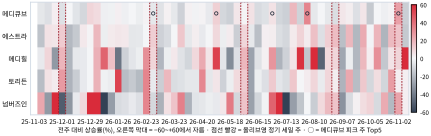
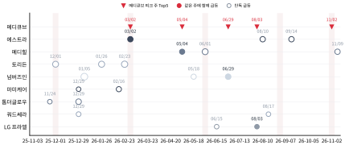
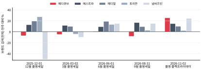
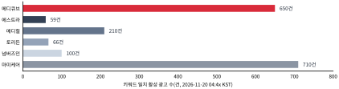

# 메디큐브 국내 피크 주 광고·이벤트 대조 분석

> v1.5 · 2026-11-21 11:18 KST

**검색·클릭 급등 54주 × 올리브영 세일·신제품 × 메타 광고 실측**

메디큐브가 크게 오른 5주는 시장이 함께 오른 주였는가 — 네이버 데이터랩·쇼핑인사이트 12개 원자료의 주간 급등 신호와, 올리브영 정기 세일·신제품·홍보 자료, 그리고 메타 광고 라이브러리 실측을 같은 주 단위로 붙였습니다.

> 이 보고서는 **원인을 단정하지 않습니다**. 시계열이 같은 주에 움직였다는 사실과, 1차 출처로 확인된 이벤트만 확정으로 적고 나머지는 [미확인]·가설로 남겼습니다.

- **작성**: 2026-11-20 · APR 지원 프로젝트 3단계
- **데이터**: 네이버 데이터랩 54주 + 쇼핑인사이트 52주 (12개 파일)
- **광고**: Meta 광고 라이브러리 KR 활성(04:4x) + Snipit 실측 27장 · 10구간(게시일 2025-12-22~2026-08-17)
- **문서**: v1.5 · 파일명 버전 제외 규칙 적용

> **포트폴리오 내 역할** — 3부작의 **3편(원소재)** 입니다. 1편 국내 트렌드 보고서 07장이 좁힌 피크 5주를 광고·이벤트 실측과 주 단위로 맞춘 대조표이고, 2편에서 정한 **2030 글로우 숏폼·5060 GS샵 X2 정적 소재의 5단계 경쟁사 표현 대조**가 이 보고서의 메타 광고·Snipit 표(04~06장)를 원소재로 씁니다. 결론은 01장, 수치·출처는 부록 A에 있습니다.
>
> **v1.5 변경 요약(직전 v1.4 대비)**: ① 머리말 아래에 **포트폴리오 내 역할 안내**를 넣었습니다(장 순서와 본문은 그대로 — `01 · 결론`은 이미 맨 앞입니다) ② PDF를 **메디큐브 레드 디자인 시스템(`analysis/task2/pdf.css`)** 으로 재빌드했습니다(구 초록 표지·본문 CSS 폐기). 수치·결론 변화는 없습니다.

## 01 · 결론 — 피크 5주 중 4주는 시장이 함께 올랐습니다

**메디큐브의 피크 주를 “메디큐브가 잘해서 오른 주”로 읽으면 4단계 숏폼의 근거가 약해집니다. 12개 원자료를 같은 규칙으로 다시 계산하니, 메디큐브가 크게 오른 5주 중 4주에 경쟁사도 같이 올랐고, 경쟁사가 단독으로 튄 주는 대부분 메디큐브와 무관한 그 브랜드의 제품 이슈였습니다.**

**01 — 올리브영 정기 세일 5주 중 4주가 “공통 상승 주”입니다**

2025년 12월(11/30~12/6)·3월(3/1~3/7)·6월(5/31~6/6)·9월(8/30~9/5)·블랙프라이데이(11/1~11/7) **5개 세일 주 중 4주**에서 5개 스킨케어 브랜드 중 **2곳 이상이 검색에서 두 자릿수(%)**로 함께 올랐습니다. 예: 6월 세일 주 메디힐 +18.7%·넘버즈인 +14.7%·토리든 +13.1%, 9월 세일 주 에스트라 +16.5%·넘버즈인 +14.8%, 12월 세일 주 토리든 +27.1%·메디힐 +19.2%. **3월 세일 주만 검색이 아니라 클릭에서 컸습니다**(메디큐브 클릭 +90.0%·에스트라 +18.1%·메디힐 +16.7%).

**02 — 메디큐브 피크 5주 = 공통 4 + 카테고리 1**

2026-11-02(블프)·2026-03-02(3월 세일, 클릭에서 동반)·2026-05-04(가정의 달)·2026-06-29(**네이버플러스 스토어 “넾다세일” 6/22~7/5**, 경쟁 4사 동반)는 시장 공통 주, **2026-08-03만** 스킨케어 경쟁사가 조용한 가운데 디바이스 경쟁 3곳(쿼드쎄라 +34%·프라엘 +23%·톰더글로우 +13%)이 같이 올라 **디바이스 카테고리 주**로 분류됩니다. 그 주에 메디큐브는 **8/3 시작 11주년 대감사제**를 열었고, 경쟁 3사도 홈쇼핑·신제품·한정판을 동시에 집행했습니다(v1.1 Snipit 실측).

**03 — 메디큐브 피크의 절반은 자사 신제품·모델 캠페인과 겹칩니다**

2026-03-23 부스터프로 X2 공식 출시(+3/25 장원영 CF), 2026-05-01 부스터 글로우 올리브영 선출시, 2026-05-09 GS샵 부스터프로X2 홈쇼핑 최초 론칭, 2026-06-08 부스터프로 X2 조앤프렌즈 에디션 — 네 건 모두 피크 주 또는 그 전주에 걸립니다. 특히 5/4 주는 **글로우 라인 +89.9%**와 **5060 검색 +27.3%**가 동시에 났습니다.

**04 — 단독 급등은 “제품·랭킹 뉴스”가 만들었습니다**

넘버즈인 2026-01-05(+322.6%, 연중 최고)는 **자사몰 “마켓 OPEN” 3일 행사(1/5~1/7)**(E25 Snipit 실측)와 협찬 광고 다량 집행이 겹쳤고, 2026-07-06(+314.7%)은 6/30 올리브영 하루 오특 40%·7/8 썸머마켓 선행 티징(E26 Snipit 실측)과 1번·3번 라인 이슈가 겹친 구간, 메디힐 2026-11-09(+119.5%, 연중 최고)는 11월 올영픽 “1위 패드”, 토리든 2026-01-26(연중 최고)은 **올리브영 단독 선런칭과 남성 크리에이터 협찬**(E27 Snipit 실측)이 겹친 구간입니다. 반면 같은 기간 메디큐브 검색은 −12.8%~+7.5%로 조용했습니다. 마지막 [미확인] **6주**(디바이스 3·스킨케어 3)는 v1.4에서 Snipit 실측으로 채워 **미확인 0건**이 됐습니다(표 6-5~6-10).

**05 — 메타 광고에서 메디큐브만 “디바이스+자사몰”로 말합니다**

경쟁 4사는 전원 올리브영 세일가·1+1·어워즈 1위를 카피 앞머리에 두고 랜딩도 올리브영으로 보냅니다. 메디큐브만 **에이지알 디바이스(부스터프로X2·글로우)**와 **자사몰**(THEMEDICUBE.CO.KR)을 축으로 쓰고, 보상판매·모델(장원영·한채아)을 전면에 둡니다.

> **이 장의 성격** (확인) — 아래 02~05장의 수치는 전부 원자료에서 다시 계산한 값이고, 04·05장의 이벤트는 1차 출처 URL이 붙거나 광고 게재일이 실측으로 잡힌 것만 “확인”으로 적었습니다. 인과는 확정하지 않았습니다.

> 출처: 계산 work/stage3/picks·nums·charts.py · 원자료 downloads/naver-datalab-v2/*(10) + downloads/datalab_메디큐브 주력 라인 비교*.xlsx(2) · 광고 조회 facebook.com/ads/library (2026-11-20 04:4x KST) · Snipit 실측 27장 · 10구간 (게시일 2025-12-22~2026-08-17)

---

## 02 · 경쟁사 피크 주 — 12개 원자료에서 같은 규칙으로 뽑았습니다

2단계에서 메디큐브의 피크 주 Top 5를 뽑은 규칙(전주 대비 상승 신호 수 × 가중치)을 **경쟁사에도 그대로 적용**했습니다. 규칙을 브랜드마다 바꾸면 “경쟁사만 유난히 튄 주”를 임의로 고를 수 있기 때문입니다.

### 선정 규칙 (표 3-1)

**표 3-1. 경쟁사 피크 주 점수식 (2단계와 동일)**

| 항목 | 내용 |
|---|---|
| 신호 | 스킨케어 4사: 브랜드 검색(전체·2030·5060) 3 + 쇼핑 클릭(전체·2030·5060) 3 = 6신호 / 디바이스 4사: 검색 3신호 |
| 점수 | +20% 이상 신호 수 ×2 ＋ +10~20% 신호 수 ×1 ＋ 해당 신호 연중 최고치 ×2 |
| 노이즈 차단 | 직전 주 값이 5 미만인 신호는 계산에서 제외(1→3 같은 작은 밑자리 급등 배제) |
| 표시 | 스킨케어 Top 3주 / 디바이스 Top 2주. 괄호 안은 직전 주 → 해당 주 값 |

*※ 메디큐브는 이 표의 대상이 아닙니다. 2단계 Top 5(2026-11-02·08-03·05-04·03-02·06-29)는 **라인 3신호를 더한 7신호 규칙**으로 뽑았으므로, 여기의 6신호 점수와 직접 비교할 수 없습니다. 6신호로 다시 계산하면 메디큐브의 최고 점수 주는 2026-03-02(10점)로, 경쟁사 1위(넘버즈인 18점·토리든 15점)보다 낮습니다. 즉 이 표의 점수는 “신호가 몇 개 겹쳤나”이지 브랜드 크기 순위가 아닙니다.*

*그림 3-1. 5개 브랜드 × 54주 상승률 히트맵 — 붉을수록 그 주에 크게 올랐습니다* — 점선 = 올리브영 정기 세일 주, ○ = 메디큐브 피크 Top5. 세일 주에 세로줄이 생기는지가 이 그림의 질문입니다.

### 스킨케어 경쟁 4사 Top 3주 (표 3-2)

**표 3-2. 경쟁 4사 피크 주 Top 3 (전주 대비 %, 직전→해당 값)**

| 브랜드 | 순위 | 주 | 점수 | +20% 이상 신호 (직전→값) |
|---|---|---|---|---|
| 에스트라 | 1 | 2026-09-14 | 10 | 5060검색 +29%(22.3→28.7) · 클릭전체 +68%(37→62) · 클릭2030 +25%(16→20) · 클릭5060 +183%(24→68) |
|  | 2 | 2026-03-02 | 10 | 2030검색 +21%(20.1→24.3) · 클릭2030 +80%(35→63) · 클릭5060 +51%(53→80) |
|  | 3 | 2026-08-10 | 10 | 5060검색 +20%(17.3→20.8) · 클릭전체 +36%(39→53) · 클릭2030 +38%(13→18) · 클릭5060 +79%(33→59) |
| 메디힐 | 1 | 2026-06-01 | 13 | 2030검색 +20%(12.6→15.1) · 클릭전체 +160%(10→26) · 클릭2030 +138%(8→19) · 클릭5060 +38%(13→18) |
|  | 2 | 2026-11-09 | 10 | 검색전체 +120%(12.8→28.2) · 2030검색 +216%(12.0→37.9) · 5060검색 +39%(13.0→18.1) — 연중 최고 |
|  | 3 | 2026-05-04 | 9 | 검색전체 +53%(16.3→24.9) · 2030검색 +94%(13.8→26.9) · 클릭전체 +130%(10→23) · 클릭5060 +23%(13→16) |
| 토리든 | 1 | 2026-02-23 | 15 | 검색전체 +34%(11.5→15.4) · 2030 +23% · 5060 +27%(7.8→9.8) · 클릭전체 +35%(74→100) · 클릭2030 +43%(70→100) |
|  | 2 | 2026-01-26 | 14 | 검색전체 +53%(13.5→20.6) · 2030 +39% · 5060 +62% · 클릭전체 +37%(60→82) · 클릭2030 +29% · 클릭5060 +124%(25→56) — 연중 최고 |
|  | 3 | 2025-12-01 | 13 | 검색전체 +27%(14.3→18.1) · 2030 +29%(13.2→17.0) · 클릭전체 +68%(56→94) · 클릭2030 +92%(40→77) · 클릭5060 +40%(25→35) |
| 넘버즈인 | 1 | 2026-01-05 | 18 | 검색전체 +323%(17.0→71.9) · 2030 +433%(16.9→89.9) · 5060 +120%(9.4→20.6) · 클릭전체 +42% · 클릭2030 +54% · 클릭5060 +27% — 세 신호 연중 최고 |
|  | 2 | 2026-06-29 | 11 | 검색전체 +43%(7.4→10.6) · 2030 +39% · 클릭전체 +50%(12→18) · 클릭2030 +42% · 클릭5060 +117%(6→13) |
|  | 3 | 2026-05-18 | 9 | 검색전체 +36%(8.2→11.2) · 2030 +27% · 5060 +74%(5.6→9.8) · 클릭2030 +33% |

### 디바이스 경쟁 4사 Top 2주 (표 3-3)

**표 3-3. 디바이스 경쟁 4사 피크 주 Top 2 (검색 3신호)**

| 브랜드 | 순위 | 주 | 점수 | +20% 이상 신호 |
|---|---|---|---|---|
| 마미케어 | 1 | 2026-02-16 | 9 | 검색전체 +26%(79.3→100.0) · 5060 +29%(39.3→50.9) · 2030 +20% — 이 주가 브랜드 연중 최고 |
|  | 2 | 2025-12-29 | 6 | 검색전체 +27%(56.1→71.2) · 2030 +30%(52.1→67.5) · 5060 +22%(33.9→41.5) |
| 톰더글로우 | 1 | 2025-12-29 | 11 | 검색전체 +30%(72.6→94.6) · 2030 +37%(50.3→69.1) · 5060 +16% |
|  | 2 | 2025-11-24 | 6 | 검색전체 +42%(42.2→60.0) · 2030 +53%(29.2→44.6) · 5060 +29%(51.2→65.8) |
| 쿼드쎄라 | 1 | 2025-12-29 | 7 | 검색전체 +34%(47.8→64.2) · 2030 +17% |
|  | 2 | 2026-08-17 | 6 | 검색전체 +47%(31.5→46.4) · 2030 +52%(31.0→46.9) · 5060 +38%(15.6→21.5) |
| LG 프라엘 | 1 | 2026-06-15 | 6 | 검색전체 +38%(18.0→24.9) · 2030 +43%(10.9→15.6) · 5060 +34%(18.2→24.5) |
|  | 2 | 2026-08-03 | 6 | 검색전체 +23%(17.6→21.6) · 2030 +28% · 5060 +30%(19.2→25.1) — 메디큐브 피크 2위와 같은 주 |

> **읽는 법** (해석) — 디바이스 4사의 점수는 스킨케어만큼 크지 않습니다. 5개 브랜드 안에서 서로 비중을 나눠 쓰기 때문에 한 브랜드가 2배로 뛰는 일이 드물고, 검색 모수도 작습니다. **디바이스 주는 “누가 먼저 크게 튀었나”보다 “누가 같이 올랐나”로 읽어야 합니다.**

> 출처: 계산 work/stage3/pick.py(점수)·classify.py · 원자료 12개 전부 · 표의 값은 부록 A-3 수치 대장과 동일

---

## 03 · 교차 분류 — 같이 오른 주와 혼자 오른 주를 갈랐습니다

분류 기준은 두 가지뿐입니다. ① 같은 주(월~일)에 **메디큐브 피크 Top 5**가 있는가 ② 그 주에 메디큐브와 경쟁사가 **같은 방향으로 두 자릿수** 상승했는가. 둘 중 하나라도 성립하면 “공통(시장 이벤트 가설)”, 메디큐브 신호가 모두 +5% 미만인데 경쟁사만 +20% 이상이면 “단독(그 브랜드 이슈 가설)”로 적었습니다.

*그림 4-1. 12개 피크 주의 위치 — ▼ = 메디큐브 피크 주 Top5, 채운 원 = 같은 주에 함께 급등, 빈 원 = 단독 급등* — 원 크기는 점수, 점 위 날짜는 그 주(월요일)입니다. 세로 띠는 올리브영 정기 세일 주.

### 분류 결과 (표 4-1)

**표 4-1. 피크 주 교차 분류 — 12개 스킨케어 피크 + 8개 디바이스 피크**

| 분류 | 주 | 해당 브랜드(점수) | 그 주에 같이 움직인 신호 |
|---|---|---|---|
| 공통 — 시장 이벤트 | 2026-11-02 | 넘버즈인(11) · 메디큐브 Top5 | 블프 주. 넘버즈인 검색 +24.2%·에스트라 +14.6%·메디힐 2030 +20.8% |
| 공통 — 시장 이벤트 | 2026-06-29 | 넘버즈인(11) · 메디큐브 Top5 | 경쟁 4사 전원 상승: 에스트라 클릭 +56.7%·메디힐 검색 +28.3%·토리든 클릭 +82.4%·넘버즈인 검색 +43.1% |
| 공통 — 시장 이벤트 | 2026-03-02 | 에스트라(10) · 메디큐브 Top5 | 3월 세일 주. 클릭에서 동반: 메디큐브 +90.0%·에스트라 +18.1%·메디힐 +16.7% |
| 공통 — 시장 이벤트 | 2026-05-04 | 메디힐(9) · 메디큐브 Top5 | 가정의 달. 메디힐 검색 +53.3%·메디큐브 +11.2%·마미케어 디바이스 +11.9%·톰더글로우 +11.7% |
| 공통 — 시장 이벤트 | 2025-12-01 | 토리든(13) | 12월 세일 주. 토리든 +27.1%·메디힐 +19.2%·에스트라 +12.6%가 검색에서 동반 상승(넘버즈인은 −50.2%) |
| 공통 — 카테고리 | 2026-08-03 | 프라엘(6) · 메디큐브 Top5 | 스킨케어 경쟁 4사는 조용, 디바이스 3곳 동반(쿼드쎄라 +34.0%·프라엘 +22.9%·톰더글로우 +12.5%). 같은 주 메디큐브 11주년 대감사제·경쟁 3사 캠페인 동시 집행(Snipit 실측) |
| 공통 — 연말 | 2025-12-29 | 톰더글로우(11)·쿼드쎄라(7)·마미케어(6) | 5곳 중 4곳 두 자릿수: 톰더글로우 +30.2%·쿼드쎄라 +34.1%·마미케어 +26.9%·에이지알 +10.5% |
| 단독 — 브랜드 이슈 | 2026-01-05 | 넘버즈인(18) | 메디큐브 +7.5%에 그침. 넘버즈인 세 신호 연중 최고(검색 +323.0%) |
| 단독 — 브랜드 이슈 | 2026-06-01 | 메디힐(13) | 메디큐브 0.0%. 메디힐 클릭 +160%·에스트라 +13.0%·넘버즈인 +28.6% (세일 주 성격이 섞임) |
| 단독 — 브랜드 이슈 | 2026-11-09 | 메디힐(10) | 메디큐브 −12.8%. 메디힐 연중 최고(+120.0%) |
| 단독 — 브랜드 이슈 | 2026-09-14 | 에스트라(10) | 메디큐브 +2.8%. 에스트라 5060 클릭 +183.3% |
| 단독 — 브랜드 이슈 | 2026-08-10 | 에스트라(10) | 메디큐브 −4.4% |
| 단독 — 브랜드 이슈 | 2026-01-26 | 토리든(14) | 메디큐브 +2.1%. 토리든 연중 최고(20.6) |
| 단독 — 브랜드 이슈 | 2026-02-23 | 토리든(15) | 메디큐브 +1.0% |
| 단독 — 브랜드 이슈 | 2026-05-18 | 넘버즈인(9) | 메디큐브 −12.6% |
| 단독 — 브랜드 이슈 | 2026-02-16 | 마미케어(9) | 설 연휴. 같은 주 메디큐브 에이지알이 디바이스 연중 최고(49.8) — 디바이스 공통 성격 |

### 세일 주는 정말 “다 같이” 오르는가 (표 4-2)

위 분류가 우연이 아닌지 확인하려고, 올리브영 정기 세일 5주만 따로 떼어 **브랜드 검색(전체)** 상승률을 세어 봤습니다. **4주에서 2곳 이상**이 두 자릿수로 올랐고, 3월 세일 주만 검색이 아니라 **클릭**에서 동반 상승했습니다(에스트라 클릭 +18.1%·메디힐 +16.7%, 메디큐브 +90.0%). 같은 표에서 **넘버즈인은 12월 세일 주에 −50.2%**로 역주행했는데, 세일 주라도 브랜드별로 방향이 갈릴 수 있다는 뜻입니다.

**표 4-2. 올리브영 정기 세일 주의 브랜드 검색(전체) 상승률**

| 세일 | 기간(출처) | 메디큐브 | 에스트라 | 메디힐 | 토리든 | 넘버즈인 | 두 자릿수 브랜드 |
|---|---|---|---|---|---|---|---|
| 2025 12월 | 11/30~12/6 (E17·2차) | −7.0% | +12.6% | +19.2% | +27.1% | −50.2% | 3곳 |
| 2026 3월 | 3/1~3/7 (E01) | −4.6% | +11.3% | +9.5% | −4.1% | −9.7% | 1곳(클릭은 3곳) |
| 2026 6월 | 5/31~6/6 (E17·2차) | +0.6% | +9.0% | +18.7% | +13.1% | +14.7% | 3곳 |
| 2026 9월 | 8/30~9/5 (E02) | −8.0% | +16.5% | +9.1% | +2.5% | +14.8% | 2곳 |
| 올영 블프 | 11/1~11/7 (E03) | +25.2% | +14.6% | +9.7% | +2.0% | +24.2% | 3곳 |

> **주의** (해석) — 12월·6월 세일의 기간은 2차 집계(E17)로 확인했고, 공식 보도자료는 3월(E01)·9월(E02)·블프(E03)만 확보했습니다. 기간이 하루 어긋나면 주 경계가 바뀔 수 있어 이 두 줄은 **“2차 출처 기준”**으로 표시했습니다.

*그림 4-2. 세일 5주의 브랜드별 상승률* — 메디힐이 12월·6월·9월 세일에서 두드러지고, 메디큐브는 9월·블프에 강합니다. 세일마다 “주인공”은 바뀝니다.

> 출처: 계산 work/stage3/classify.py · 세일 기간 E01·E02·E03·E17 (§부록 A-4)

---

## 04 · 메디큐브 피크 5주 — 그 주에 실제로 무엇이 있었나

2단계에서 세운 가설을 1차 출처와 광고 게재 실측으로 하나씩 확인했습니다. **확인**은 보도자료·공식 페이지로 날짜가 잡힌 것, 또는 광고 게재일이 실측으로 잡힌 것(Snipit·메타 광고 라이브러리), **부분 확인**은 상품명·2차 집계처럼 1차에 가까운 흔적만 있는 것, **[미확인]**은 근거를 찾지 못한 것입니다. v1.1에서는 윤서 님이 2026-11-20 11:01 #pickle에 올린 **Snipit 실측 4장(게시일 2026-07-27~08-09)**을, v1.2에서는 같은 날 추가로 올린 **3구간 11장**(2025-12-29~2026-01-11 · 2026-01-19~02-01 · 2026-06-22~07-05)을 각각 별도 표로 반영했습니다.

**표 5-1. 메디큐브 피크 5주 이벤트·광고 대조**

| 주 | 그 주의 메디큐브 신호 | 확인된 이벤트 · 1차 출처 | 판정 |
|---|---|---|---|
| 2026-11-02 (11/2~11/8) | 검색 52.8(+25.2%) · 2030 46.6(+24.1%) · 5060 60.3(+22.0%) · PDRN 24.2(+30.2%) · 글로우 22.4(+20.0%) · 제로모공패드 +66.8% | 올리브영 블랙프라이데이 **11/1~11/7** (E03 CJ올리브영 2026-10-29). 같은 기간 메디힐 인플루언서 광고가 “블랙프라이데이 특가 (~11/7)”를 명시, 에스트라는 11/7 크림 더블기획 소재를 개시(E15). 11월 올영픽 상품명에 메디큐브 PDRN 핑크 앰플 “1등미백앰플”(E14) | 확인 · 공통(시장) |
| 2026-08-03 (8/3~8/9) | 검색 56.3(+33.1%) · 2030 49.0(+31.2%) · 5060 65.4(+35.3%) · 클릭 21(+75.0%) · 클릭2030 9(+200%) | **8/3~8/24 메디큐브 11주년 대감사제** — 8/3 시작 Meta 광고(22일 게재) “메디큐브 11주년 공식몰 단독특가 시작 / 최대 100원딜부터 디바이스 역대급 혜택 등장”, 8/4 요즘리뷰 소재(21일 게재)에 디바이스 단품 11% 쿠폰(8/3~8/24)·PDRN 마스크팩 10장 증정(8/3~8/7)·화요특가 11,000원 추가 할인(8/4·8/11·8/18)·신규회원 990원 특가(**E24 Snipit 실측**). 8/1 일본 Qoo10 부스터 글로우 출시·조앤프렌즈 에디션 동시 발매(E06 계열)도 같은 주 | 확인 · 디바이스 카테고리 |
| 2026-05-04 (5/4~5/10) | 5060 85.2(+27.3%) · 부스터 프로 73.7(+30.2%) · 부스터 글로우 27.7(+89.9%) · 클릭5060 27(+22.7%) | **부스터 글로우 올리브영 선출시 5/1**(E06 연합뉴스 2026-04-30). **GS샵 부스터프로X2 홈쇼핑 최초 론칭 5/9**(E07 뉴스와이어 2026-05-08). 5/8 어버이날·가정의 달. 같은 주 메디힐 +53.3% 동반 | 확인 · 공통 + 자사 신제품 |
| 2026-03-02 (3/2~3/8) | 클릭 38.0(+90.0%, 연중 최고) · 클릭2030 33(+312.5%) · 클릭5060 28(+115.4%) · PDRN 75.9(+28.0%) | **3월 올영세일 3/1~3/7**(E01 CJ뉴스룸 2026-02-27). 단, 검색(브랜드)은 −4.6%로 내려 이 주의 상승은 **클릭·라인**에 집중 | 확인 · 공통(시장) |
| 2026-06-29 (6/29~7/5) | 글로우 35.0(+64.0%, 연중 최고) · 클릭 25(+47.1%) · 클릭5060 30(+50.0%) · 5060 검색 +11.3% | **네이버플러스 스토어 “넾다세일” 6/22~7/5**가 시장 배경(메디힐 6/26·토리든 6/30 광고에서 날짜 확인). 메디큐브는 **6/27 한채아 물방울 초음파(NEW 부스터 글로우) 14일 게재**·7/2 제로모공 2종 주말 3일특가·7/3 메디큐브×올리브영 7월 한달 특가를 같은 구간에 집행(**E26 Snipit 실측**). 6월 올영픽 마지막 주(E16 2차)도 겹침 | 확인 · 공통(시장) |

### 같은 주 경쟁 3사 — Snipit 실측 (표 5-3 · v1.1 신규)

8/3 주가 정말 디바이스 카테고리 주였는지, 같은 기간(게시일 2026-07-27~08-09) 경쟁 3사가 무엇을 집행했는지 Snipit으로 직접 확인했습니다. 세 브랜드 모두 **한 주에 여러 소재를 동시에** 돌렸고, 소구점은 서로 달랐습니다.

**표 5-3. 2026-08-03 주 경쟁 3사 광고 실측 (Snipit · 게시일 2026-07-27~08-09)**

| 브랜드 | 게시일 (게재일수) | 무엇을 밀었나 (원문 요약) | 성격 |
|---|---|---|---|
| 쿼드쎄라 | 07-27 (1일) | “잠티 흔적 균대비! 펄샷 Live / 쿼드쎄라 펄샷 52% 할인” | 가격·라이브 |
| 쿼드쎄라 | 08-02 (1일) | “피부과 시술 5개를 한번에? 수많은 쇼호스트들의 선택, 쿼드쎄라 펜타” — ON AIR 8/3(월) 11시 55분, GS 홈쇼핑 | 홈쇼핑 방송 |
| 쿼드쎄라 | 07-28 (13일) | 쿼드쎄라 신규회원 댓글 참여 이벤트 — 245만원 상당 경품 등 총 7가지 | 신규 유입 |
| 쿼드쎄라 | 08-07 (인스타그램) | 신제품 틴즈(TEEN’Z) 카카오쇼핑 LIVE 예고 — “하루 10분! UP TO 28%” / LIVE 8/11(화) 오후 7시 | 신제품 |
| LG 프라엘 | 07-30 (20일) | “NEW 멜라빔 토닝 + 전용 스탠드 LG 프라엘 브랜드몰 출시!” — 멜라빔 구매 시 스탠드 43% 할인 | 신제품 출시 |
| LG 프라엘 | 08-02 (24일 · 조회 상위 90%) | “미백 + 장벽 동시 케어로 다운 타임 없는 미백 관리” | 상위 노출 |
| LG 프라엘 | 08-04 (5일) | “이제 번거로운 억지 없이 월 3만원대로 집에서 탄력 케어” — 네이버 단독 12개월 무이자 | 가격·금융 |
| LG 프라엘 | 08-06 (3일) | “미백 디바이스로 다시 돌아온 LG 프라엘 전편 마켓(회사원A)” — 단 7일간 20% OFF + 트리플 토닝샷 본품 증정 | 인플루언서 |
| 톰더글로우 | 08-03 (13일) | 톰 더 글로우 시그니처 × 키티버니포니(kbp) 한정판 콜라보 에디션 — 단독특가 총 3만원 | 한정판 |
| 톰더글로우 | 08-04 (협찬 · yunnx.nn) | 같은 kbp 콜라보 에디션 협찬 소재 | 인플루언서 |
| 톰더글로우 | 07-30 (24일 · 조회 상위 2%) | “여행가서도 놓칠 수 없는 / 피부 관리 입소문 1등 속보습관리 / [하루 500원대]” — 약 −38만원 즉시할인 + 17.8만원 상당 GIFT | 상위 노출 |
| 톰더글로우 | 08-05 (20일 · 조회 상위 9%) | “톰 더 글로우 시그니처 판매 1등 · 립서비스 1위 · 품절대란” + 배지 “미국 틱톡샵 1위 · 올리브영 US 글로벌 1위” — 선착순 100대 예약 판매 | 글로벌 실적 |

> **읽는 법** (해석) — 8/3 주는 메디큐브만의 이벤트가 아니었습니다. 메디큐브는 **자사몰 11주년 대감사제**(디바이스 11% 쿠폰·마스크팩 증정·화요특가), 쿼드쎄라는 **GS샵 홈쇼핑 방송과 신제품 틴즈**, LG 프라엘은 **멜라빔 신제품 출시와 인플루언서 마켓**, 톰더글로우는 **kbp 한정판과 조회 상위 2% 여행 소구**를 같은 주에 걸었습니다. 표 4-1의 “공통 — 카테고리” 분류와 같은 방향이며, 어느 것이 검색 상승을 만들었는지는 이 자료로 가를 수 없습니다.

### 2026-06-29 주 — 6/22~7/5 스니핏 실측 (표 5-4 · v1.2 신규)

6/29 주가 “경쟁 4사 동반”이었던 이유를 Snipit으로 확인했습니다. **네이버플러스 스토어 “넾다세일”(2026-06-22~07-05)**가 시장 행사로 깔렸고(메디힐 6/26·토리든 6/30 광고에서 기간 확인), 5개 브랜드가 각자 다른 채널 행사를 같은 구간에 걸었습니다. 7/27~8/9·12/29~1/11 실측과 섞이지 않도록 **구간을 나눠** 적습니다.

**표 5-4. 2026-06-22~07-05 구간 5개 브랜드 광고 실측 (Snipit)**

| 브랜드 | 게시일 (게재일수) | 무엇을 밀었나 (원문 요약) | 성격 |
|---|---|---|---|
| 메디큐브 | 06-27 (14일) | “한채아 물방울 초음파 / 메디큐브 NEW 부스터 글로우” — 12개월 무이자·공식몰 특가 | 신제품·자사몰 |
| 메디큐브 | 07-02 (5일) | “주말 3일특가 / 최대 1만원대 / 메디큐브 제로모공 2종 단독 특가” | 주말 특가 |
| 메디큐브 | 07-03 (30일) | “메디큐브 × 올리브영 / 7월 한달간 특가” — 부스터프로 X2 | 올리브영 기획 |
| 에스트라 | 06-29 (3일) | 무신사 “에스트라 최대 12% 할인 + 전용 20% 쿠폰·단독 사은품 증정” | 무신사 행사 |
| 에스트라 | 06-30 (17일) | 아모레퍼시픽몰 “엄마가 선택한 에스트라, 자극없는 120h 보습의 힘” | 자사몰 행사 |
| 에스트라 | 06-30 (6일) | “에스트라 장벽케어 선크림(더마UV) 33% 특가” | 가격 소구 |
| 에스트라 | 07-05 (2일) | “7/6 단 하루! 아토베리어365 스페셜 오특 25·31·32% OFF” | 하루 특가 |
| 메디힐 | 06-26 (3일) | “든든한 특가 LIVE 메디힐 × KBO — 6/28 오후 8시 30분” | 스포츠 콜라보 라이브 |
| 메디힐 | 06-26 (8일) | 네이버플러스 스토어 “넾다세일 06.22~07.05 — 베스트 여름 마스크팩 3종, 최대 10만원” | 네이버 행사 |
| 메디힐 | 06-29 (협찬 · 아인이다, 11일) | “아니 이렇게 메디힐 남기는 있어요?” | 협찬 광고 |
| 메디힐 | 06-30 (24일) | “패드 맞짱 본점 200매 2만원대” — 네모패드 1+1 | 올리브영 기획 |
| 메디힐 | 07-05 (3일) | 카카오톡 선물하기 “에센셜 마스크 30매 29,200원(정가 60,000원)” | 선물하기 |
| 토리든 | 06-23 (9일) | 마켓컬리 “다이브인 세럼 기획세트 69% — 29,000원 → 8,950원” | 마켓컬리 행사 |
| 토리든 | 06-30 (6일) | 네이버플러스 스토어 “넾다세일 — 토리든 BEST UP TO 57%” | 네이버 행사 |
| 토리든 | 06-23·06-26 (인스타그램) | 아이즈매거진(1.9만 좋아요)·구준 인사이트·룩스 마케팅 매거진 — 성분·흡수 서사 | 인플루언서 매거진 |
| 토리든 | 06-26 (3일)·07-05 (4일) | “웰라쥬 VS 토리든” 비교형 Meta 광고 | 비교형 |
| 넘버즈인 | 06-24 (17일) | “넘버즈인 비밀 프로 1만원대” | 가격 소구 |
| 넘버즈인 | 06-28 (3일) | “6/30(화) 단 하루! 오특 40% — 27,000원 → 16,000원” | 하루 특가 |
| 넘버즈인 | 07-02 (7일) | “넘버즈인 썸머마켓 Open! 7/8~7/12 · UP TO 71% · NCT WISH 포스터” (선행 티징) | 자사몰 행사 예고 |
| 넘버즈인 | 07-05 (4일) | “역대급 썸머마켓 71% · 선착순 블러 파우더 미니 증정” | 자사몰 행사 |

> **읽는 법** (해석) — 6/29 주의 공통 상승은 **네이버플러스 스토어 “넾다세일”(6/22~7/5)**라는 시장 행사에 각 브랜드의 채널 행사(무신사·아모레몰·마켓컬리·올리브영·카카오 선물하기)가 겹친 구간으로 보입니다. 메디큐브도 같은 구간에 **6/27 부스터 글로우(한채아)**·7/2 제로모공 주말특가·7/3 올리브영 7월 특가를 걸었습니다. 넘버즈인의 7/6 급등은 6/30 하루 오특 40%와 7/8 썸머마켓 선행 티징이 앞선 구간입니다. 어느 소재가 얼마큼 기여했는지는 이 자료로 가를 수 없습니다.

### 가설에서 빠진 것 — 같이 봐야 할 두 주 (표 5-2)

**표 5-2. Top5 밖 참고 주**

| 주 | 신호 | 확인된 이벤트 | 판정 |
|---|---|---|---|
| 2026-03-16 | 부스터 프로 100.0(+115.0%, 연중 최고) | **부스터프로 X2 3/23 공식몰 출시**(E04 연합뉴스 2026-03-23), 3/25 장원영 TV CF 공개(E05) — 출시 **직전 주**에 라인 검색이 먼저 뛰었습니다 | 확인 · 신제품 선행 |
| 2026-08-31 | 메디큐브 클릭 +40.0% · 5060 클릭 +90.9% | **9월 올영세일 8/30~9/5**(E02), 메디힐 광고 8/29 “올영세일” 소재 개시, 마미케어 8/28 올영세일 소재 | 확인 · 공통(시장) |

> **인과에 대해** (주의) — 5/4 주를 예로 들면 “부스터 글로우 출시가 검색 +27.3%(5060)를 만들었다”고 쓸 수 없습니다. 같은 주에 어버이날과 GS샵 방송이 겹쳤고, 메디힐은 더 크게 올랐습니다. 이 보고서는 **날짜가 맞는다**까지만 확정합니다.

> 출처: E01·E02·E03·E04·E05·E06·E07·E08·E14·E15·E16·E20·E24·E26 (부록 A-4) · 신호 값은 부록 A-3

---

## 05 · 경쟁사 피크 주 — 브랜드마다 오르는 이유가 다릅니다

경쟁사 피크 주 16개 중 1차 출처·광고 실측으로 확인된 것은 **14개**, 부분 확인 2개, **미확인 0개**입니다. 확인된 14개를 성격으로 묶으면 ① **올리브영 세일·올영픽·올영 랭킹 4개**(에스트라 3/2 · 메디힐 6/1 · 메디힐 11/9 · 넘버즈인 6/29) ② **올리브영 단독 선런칭·런칭특가 2개**(토리든 1/26 · 토리든 2/23) ③ **행사·채널 3개**(에스트라 9/14 엑스포·라이브 · 에스트라 8/10 아모레 슈퍼위크 · 넘버즈인 1/5 자사몰 마켓) ④ **협업·시딩 2개**(메디힐 5/4 KBO · 넘버즈인 5/18 인스타 시딩) ⑤ **디바이스 3개**(톰더글로우 12/29 · 쿼드쎄라 8/17 · 프라엘 6/15)입니다. v1.4에서 마지막 6주를 Snipit 실측으로 채워 부록 A-6이 비었습니다 — 디바이스 3주는 **표 6-5~6-7**, 스킨케어 3주는 **표 6-8~6-10**에 구간별로 나눠 적었습니다.

**표 6-1. 경쟁사 피크 주 이벤트 대조**

| 브랜드 | 주 | 핵심 신호 | 확인된 이벤트 · 출처 | 판정 |
|---|---|---|---|---|
| 에스트라 | 2026-09-14 | 5060 클릭 +183.3% · 클릭전체 +67.6% | **대한민국 피부건강 엑스포 9/11~18 공식 후원** + 9/15 네이버 라이브커머스(아토베리어365 크림 특별할인·샘플 증정) — E10 아모레퍼시픽 뉴스룸 2026-09-15 | 확인 |
| 에스트라 | 2026-03-02 | 클릭2030 +80% · 클릭5060 +51% | 3월 올영세일(E01) + 아모레몰/올리브영 세일 카피(광고 라이브러리 E15) | 확인 |
| 에스트라 | 2026-08-10 | 클릭5060 +78.8% · 클릭전체 +35.9% | **아모레퍼시픽 “AMORE 슈퍼위크”** — 8/10 하루 수딩크림 24% OFF(72시간 수분지속), 8/11부터 캡슐토너 23% OFF 13일 게재. 8/3 뷰티 페스타(선세럼 71%·최대 21%), 8/9 캡슐토너 ~25%(SSF), 8/18 무신사 뷰티 페스타 30%, 8/19 아모레몰 첫구매 할인도 같은 구간 — **E28 Snipit 실측(게시일 2026-08-03~08-16)** | 확인 |
| 메디힐 | 2026-06-01 | 클릭전체 +160% · 클릭2030 +138% | 6월 올영세일(5/31~6/6, E17 2차) + **메디힐이 6월 올영픽**(올리브영 상품명 “6월 올영픽/15년 연속 1위”, 6/10 랭킹 E23) | 확인 |
| 메디힐 | 2026-11-09 | 검색 +119.5% · 2030 +215.7% (연중 최고) | **11월 올영픽 “1위 패드”** — 광고 라이브러리에서 메디힐 인플루언서 광고가 “[11월 올영픽/1위 패드] 더마 토너패드 100+100매”로 랜딩(E15), 11/7 브랜드 소재 다수 개시 | 확인 |
| 메디힐 | 2026-05-04 | 검색 +53.3% · 클릭전체 +130.0% | **메디힐 × KBO(양현종) 수분 선세럼 1+1 특가** — 4/30 Meta 광고 “수분 선세럼 1+1 특가 / 메디힐 X 양현종 / OLIVE YOUNG” + KBO 한정판 굿즈·야구 하이라이트 인스타그램(5/8). 5월 세일 없이 **콜라보·1+1**로 검색이 올랐습니다 — **E30 Snipit 실측(게시일 2026-04-27~05-10)** | 확인 |
| 토리든 | 2025-12-01 | 검색 +27.1% · 클릭2030 +92.5% | 12월 올영세일(11/30~12/6, E17 2차) 구간. 11/1~11/15 광고에서 “올영 단독 기획 31% OFF” 다수(E15) | 부분 확인 |
| 토리든 | 2026-01-26 | 검색 +52.8% (연중 최고) · 클릭5060 +124.0% | **1/26(월) 올리브영 최초 공개 — 신제품 “솔리드인 포맨 세라마이드 보습 올인원” 올리브영 단독 선런칭**(6일간 17,900원+선착순 증정), 남성 크리에이터 **스완 PICK** 협찬 광고(런칭 특가 1만원대+증정) — **E27 Snipit 실측(게시일 2026-01-19~02-01)** | 확인 |
| 토리든 | 2026-02-23 | 검색 +33.5% · 클릭전체 +35.1% (클릭 연중 최고) | **2/22 NEW 톤업선크림 런칭특가(1만 원대, 7일 게재)**·**2/24 올영PICK 올인원 3일만 36% OFF·총 220g(15,900원, 4일)** + 3/1 오특(1등 수분세럼 33%) 티징, 인스타 시딩 3건(2/16 강나영·2/23 민희 뷰티·3/1 조효진) — **E30 Snipit 실측(게시일 2026-02-16~03-01)** | 확인(복수 런칭·시딩) |
| 넘버즈인 | 2026-01-05 | 검색 +322.6% · 2030 +433.0% (연중 최고) | **1/5~1/7 넘버즈인 공식몰 “마켓 OPEN”** — 단 3일 9,900원 특가(2,990원부터)·최대 63% 할인, NCT WISH 팬사인회 응모권·인생네컷 증정, 협찬 인플루언서 광고 다수(12/30 협찬 25일 게재 등) — **E25 Snipit 실측(게시일 2025-12-29~2026-01-11)** | 확인 |
| 넘버즈인 | 2026-06-29 | 클릭5060 +116.7% · 검색 +43.1% | **6/30 21:00 올리브영 10대 판매 랭킹 1위**(1번 판토텐산 블러파우더) — E12 서울신문·중앙일보 2026-07-22 | 확인(제품 랭킹) |
| 넘버즈인 | 2026-05-18 | 5060 검색 +73.9% | **3번 신상(버블팩) 인스타 시딩·공식 이벤트 집중** — 5/15 공식 인스타 “숨은 넘버즈인 3번 미니어처 찾기”(좋아요 4천)·5/22 @eunchogreen 시딩(4.8천)·5/23 지지매거진·5/24 크리에이터 다수. Meta 유료 광고가 적은 구간 — **E30 Snipit 실측(게시일 2026-05-11~05-24)** | 확인(시딩·이벤트) |
| 마미케어 | 2026-02-16 | 검색 +26.1% (연중 최고) · 5060 +28.6% | **2026년 설날 2월 17일** 연휴 주. 같은 주 메디큐브 에이지알도 디바이스 연중 최고(49.8) — 디바이스 카테고리 공통 | 부분 확인 |
| 톰더글로우 | 2025-12-29 | 검색 +30.0% (연중 최고) | **12/28(일) 22:40 톰 더 글로우 PRO 최초 런칭 특가(500명 한정)** 예고·집행 + **시그니처 6차 재입고·자사몰 한정 기획세트(30만 원대, 선착순 500명)** + 아옳이·유인나 PICK 인플루언서 소재 — **E29 Snipit 실측(게시일 2025-12-22~2026-01-04)** | 확인 |
| 쿼드쎄라 | 2026-08-17 | 검색 +47.0% | **8/17(월) 10시 55분 롯데홈쇼핑 LIVE** — “쿼드쎄라 펜타 티타늄 5중 초음파”, 사전알림신청 혜택(커피쿠폰)·한정 구성 소재 — **E29 Snipit 실측(2026-08-17 주)** | 확인 |
| LG 프라엘 | 2026-06-15 | 검색 +38.0% | **6/14 NEW 멜라빔 토닝 — “LG 프라엘 미백 디바이스 출시”** Meta 광고 13일 게재(6/14~6/26) — **E29 Snipit 실측(게시일 2026-06-14)** | 확인 |

### 추가 확인 — 넘버즈인 2026-01-05 (Snipit 2025-12-29~2026-01-11) (표 6-2 · v1.2 신규)

넘버즈인 2026-01-05는 **연중 최고(+322.6%)**였는데 v1.0까지 원인을 못 찾았던 주입니다. Snipit으로 그 구간을 따로 조회하니 **자사몰 3일 행사와 협찬 광고**가 겹쳐 있었습니다. 7/27~8/9 실측과 섞이지 않도록 **구간을 나눠** 적습니다.

**표 6-2. 넘버즈인 광고 실측 (Snipit · 게시일 2025-12-29~2026-01-11)**

| 게시일 (게재일수) | 무엇을 밀었나 (원문 요약) | 성격 |
|---|---|---|
| 12-29 (4일) | “넘버즈인 공식몰에서 하나만 사도 무료배송” | 자사몰 |
| 12-29 (인스타그램 · 써니 @ssunkter) | “30대 직장인 피부관리템 넘버즈인 2번팩” | 인플루언서 |
| 12-30 (협찬 · hywt_h_a, 25일) | “넘버즈인 공식몰에서 단독 할인 중 (56,000원 → 28,000원)” | 협찬 광고 |
| 01-02 (3일) | “넘버즈인 마켓 OPEN 1.5(월)~1.7(수) / Up to 63% OFF” + NCT WISH 팬사인회 응모권·인생네컷 증정 | 자사몰 행사 |
| 01-04 (2일) | “1/5~1/7 넘버즈인 1월 응모형 마켓 OPEN / 단 3일 9,900원 특가 / 2,990원부터” | 자사몰 행사 |
| 01-04 (2일) | “BEST 응급 진정팩 9천원대 / 단 3일 공식몰 단독 63% 할인” | 자사몰 행사 |
| 01-07 (인스타그램) | 브랜드 영상 소재(마켓 D-day) | 브랜드 |
| 01-09 (협찬 · nys._.1201, 6일) | “넘버즈인 3번 세럼 하나만 사도 5종 무료 증정” | 협찬 광고 |
| 01-09 (3일) | “결을 손질해줄 스킨부스터 / 올영 1+1 기획 11,450원 / SPF50+” | 올리브영 기획 |

> **읽는 법** (해석) — 이 주의 급등은 올리브영 세일이 아니라 **자사몰 3일 행사(1/5~1/7)**와 **협찬 광고 다량 집행**이 겹친 구간입니다. 지금까지의 “메디큐브는 자사몰·홈쇼핑, 경쟁사는 올리브영” 구도에 **예외 하나**를 더합니다 — 넘버즈인도 자사몰 행사로 검색을 끌어올린 사례입니다. 어느 소재가 얼마큼 기여했는지는 이 자료로 가를 수 없습니다.

### 추가 확인 — 토리든 2026-01-26 (Snipit 2026-01-19~02-01) (표 6-3 · v1.2 신규)

토리든 2026-01-26도 **연중 최고(+52.8%)**였는데 v1.0까지 원인을 못 찾았습니다. Snipit으로 확인하니 **신제품 올리브영 단독 선런칭**과 남성 크리에이터 협찬이 겹쳤습니다.

**표 6-3. 토리든 광고 실측 (Snipit · 게시일 2026-01-19~02-01)**

| 게시일 (게재일수) | 무엇을 밀었나 (원문 요약) | 성격 |
|---|---|---|
| 01-26 (6일) | “HAPPY NEW ALL IN ONE — 올리브영 최초 공개 / 솔리드인 포맨 세라마이드 보습 올인원 / 6일만! 올리브영 단독 선런칭 17,900원 + 선착순 증정” | 신제품 단독 런칭 |
| 01-26 (협찬 · 스완 PICK) | “이건 즉각적 보습력이 진짜 좋아요! · NEW 스완 PICK — 런칭 특가! 1만원대 + 증정” | 남성 크리에이터 협찬 |

> **읽는 법** (해석) — 토리든 1/26의 급등은 세일이 아니라 **신제품(솔리드인 포맨)의 올리브영 단독 선런칭**과 **남성 크리에이터 협찬**이 겹친 구간입니다. 메디큐브가 디바이스로 객단가를 올리는 동안, 토리든은 **남성·올인원**이라는 새 수요를 올리브영 단독으로 열었다는 점이 4단계 USP·타깃 판단에 참고됩니다. 인과는 확정하지 않습니다.

### 추가 확인 — 에스트라 2026-08-10 (Snipit 2026-08-03~08-16) (표 6-4 · v1.3 신규)

에스트라 2026-08-10은 **클릭5060 +78.8%**로 그 주 혼자 튄 피크였는데 v1.0까지 이유를 못 찾았습니다. Snipit에서 “에스트라·아모레퍼시픽”을 2026-08-03~08-16으로 조회하니 **아모레퍼시픽 자체 행사(AMORE 슈퍼위크)**와 외부 채널 행사가 같은 구간에 겹쳐 있었습니다.

**표 6-4. 에스트라 광고 실측 (Snipit · 게시일 2026-08-03~08-16)**

| 게시일 (게재일수) | 무엇을 밀었나 (원문 요약) | 성격 |
|---|---|---|
| 08-03 (2일) | “차단은 확실하게 케어는 강력하게 — 더마UV365 선세럼 SPF50+ PA++++ 71% 세일” / “에스트라 역대급 뷰티 페스타 최대 21%” | 가격 소구 |
| 08-04 (1일) | 11번가 파워브랜드쇼 에스트라 할인 행사 — **윤서 님 확인(화면 캡처는 없음)** | 채널 행사 |
| 08-09 (5일) | SSF SHOP “에스트라 NEW 캡슐토너 단 7일간의 혜택 ~25%” | 신제품·가격 |
| 08-10 (1일) | “AMORE 슈퍼위크 — 아토베리어365 하이드로 수딩크림 24% OFF / 72시간 수분지속” | 1일 특가 |
| 08-11 (13일) | “AMORE 슈퍼위크 — 아토베리어365 캡슐 토너 23% OFF / 수분을 움켜쥔 건강한 피부결” | 2주 캠페인 |
| 08-18 (1일) | 무신사 뷰티 페스타 “에스트라 무뷰파 최대 30% 할인 + 시즌품 증정”(08.10~08.24) | 채널 행사 |
| 08-19 (6일) | 아모레몰 “에스트라 수분 장벽 케어 — 첫구매 추가 할인 + 마스크 증정” | 자사몰 |
| 08-03 (인스타그램 · A-ditor) | “8월 한정 이벤트 — 에스트라 신상 클렌징 밀크 그냥 드려요” | 인플루언서 |

> **읽는 법** (해석) — 2026-08-10 주의 에스트라는 **아모레퍼시픽 자체 행사(AMORE 슈퍼위크)**와 **11번가·무신사·SSF 같은 외부 채널 행사**가 같은 2주에 겹친 구간입니다. 경쟁사 대부분이 올리브영 세일에 실렸던 것과 달리, 에스트라는 **자사몰·외부 채널을 함께 여는 방식**으로 클릭을 끌어올렸습니다. 11번가 8/4 행사는 윤서 님 확인만 있고 캡처가 없어 그렇게 표시했습니다. 인과는 확정하지 않습니다.

### 추가 확인 — 디바이스 경쟁 3주 (Snipit 3구간) (표 6-5~6-7 · v1.4 신규)

디바이스 3사가 왜 그 주에 올랐는지, v1.0부터 **[미확인]**으로 남겨 둔 세 주를 Snipit으로 확인했습니다. 세 브랜드의 조회 구간이 서로 달라 **표를 구간별로 나눠** 적습니다 — ① 톰더글로우 2025-12-22~2026-01-04 ② LG 프라엘 게시일 2026-06-14(13일 게재) ③ 쿼드쎄라 2026-08-17 주.

**표 6-5. 톰더글로우 광고 실측 (Snipit · 게시일 2025-12-22~2026-01-04)**

| 게시일 (게재일수) | 무엇을 밀었나 (원문 요약) | 성격 |
|---|---|---|
| 12-23 (1일) | “Sold out in 1 minute · THOME the glow signature” — 1분 완판 소구 | 완판 소구 |
| 12-25 (3일) | “12/28(일) 22:40 / 더 글로우 프로 최초 런칭 혜택 받기” — **톰 더 글로우 PRO 최초 런칭 예고** | 신제품 예고 |
| 12-25 (3일) | “마침내, 물광을 초음파 기록의 정점 — 톰 더 글로우 PRO / 정밀제어 4가지 모드로 전문가급 케어 / 12월 28일(일) 22:40 / 500명 한정 최초 런칭 특가” | 신제품 런칭 |
| 12-29 (7일 · 톰-Thome) | “아옳이 PICK 1등 물방울 초음파 / 통증·자극 없는 물광 생성기 · 톰 더 글로우 시그니처” (엄마와 함께 쓰는 사용 장면) | 크리에이터 PICK |
| 12-29 (7일 · 톰-Thome) | “선착순 500대 한정 · 단 3일 같은 예약 구매 혜택 받기” — 6차 예약 OPEN·극소량 재입고 | 예약 판매 |
| 12-29 (24일 · SkinLab) | “톰더글로우 시그니처 특가 · 30만 원대에 이 가격이 가능해요?” + 배너 **“종료 D-1”** | 자사몰 한정 특가 |
| 12-29 (40일 · SkinLab) | “톰더글로우 시그니처 특가 · 30만 원대 / 선착순 500명 한정수량 곧 종료” | 자사몰 한정 특가 |
| 12-29 (14일 · SkinLab) | “18만 명이 기다린 NEW 톰 더 글로우 시그니처 — 뜨거운 성원에 드디어 런칭했습니다 / 자사몰 한정 기획세트 · 27만 원 할인 · 30만 원대” | 런칭 기획세트 |
| 12-30 (64일 · 톰-Thome) | “아옳이 Pick — 계속 품절이라 소개 못 해드렸는데, 드디어 구매 가능” · 시그니처 재입고 혜택 + “4세대 하이엔드 물광 초음파 · 톰 더 글로우 PRO 드디어 출시” | 재입고·신제품 |
| 01-02 (4일 · 톰-Thome) | “78만 크리에이터 아옳이 PICK · 물방울 초음파 1등 동안 디바이스 / NEW 최대 78만 원 상당” | 크리에이터 PICK |
| 01-02 (26일 · SkinLab) | “사전예약 인원만 13,000명+ · 1분 품절대란 톰 더 글로우 시그니처 / 런칭 기념 4종 특가 기획 여기서만 30만 원대” | 판매 실적 소구 |
| 게시일 표기 없음 (Google Ads) | “유인나 PICK! 4세대 20중 물광생성기로 매일 달라지는 피부” · “4세대 하이엔드 물광 초음파 디바이스 — 톰 더 글로우 PRO 드디어 출시” | 배우 기용·검색 광고 |

**표 6-6. LG 프라엘 광고 실측 (Snipit · 게시일 2026-06-14 · 13일 게재)**

| 게시일 (게재일수) | 무엇을 밀었나 (원문 요약) | 성격 |
|---|---|---|
| 06-14 (13일) | “NEW 멜라빔 토닝 / LG 프라엘 미백 디바이스 출시” — 멜라빔 토닝 3종 제품 컷, 배너 “LG 프라엘 미백 디바이스 출시 >” | 신제품 출시 |

**표 6-7. 쿼드쎄라 광고 실측 (Snipit · 2026-08-17 주)**

| 게시일 (게재일수) | 무엇을 밀었나 (원문 요약) | 성격 |
|---|---|---|
| 게시일 표기 없음 (소재 내 “ON AIR 8/17(월) 10시 55분”) | “5가지 에스테틱 관리를 한 번에, 쿼드쎄라 펜타 — 티타늄 5중 초음파 / 사전알림신청 혜택(커피쿠폰) · 다시 없을 한정 구성, **롯데홈쇼핑 LIVE**에서 만나보세요” | 홈쇼핑 LIVE |

> **읽는 법** (해석) — 디바이스 3주의 공통점은 **“한정 수량·하루·한 시간”을 카피에 박아 넣은 것**입니다 — 톰더글로우는 “12/28(일) 22:40 · 500명 한정”, “종료 D-1”, “선착순 500명 한정수량 곧 종료”, 쿼드쎄라는 **홈쇼핑 방송 시각(8/17 10:55)**, 프라엘은 **신제품 출시**를 첫 줄에 둡니다. 스킨케어의 세일 문법(할인율·1+1)과 달리 **시간·수량의 희소성**이 후킹이라는 점이 4단계 숏폼 후킹 설계에 참고됩니다. 인과는 확정하지 않습니다.

### 추가 확인 — 스킨케어 잔여 3주 (Snipit 3구간) (표 6-8~6-10 · v1.4 신규)

스킨케어 3주(토리든 2/23·메디힐 5/4·넘버즈인 5/18)도 같은 방법으로 확인했습니다. 세 구간 모두 **단일 대형 행사보다 여러 접점이 겹친 주**였고, 특히 넘버즈인 5/18은 **유료 Meta 광고보다 인스타 시딩·공식 이벤트**가 중심이었습니다.

**표 6-8. 토리든 광고 실측 (Snipit · 게시일 2026-02-16~03-01)**

| 게시일 (게재일수) | 무엇을 밀었나 (원문 요약) | 성격 |
|---|---|---|
| 02-22 (7일) | “출근 준비 급할 때? 초간단! 내추럴 톤업 — **NEW 토리든 톤업선크림** / 런칭특가 1만 원대” (OLIVE YOUNG) | 신제품 런칭특가 |
| 02-24 (4일) | “새학기엔 새로운 토리든 올인원과 함께” + **올영 PICK** · 3일만 36% OFF · 총 220g | 올영픽·가격 |
| 02-16 (인스타그램 · 강나영 @narongrongrong) | “선크림 대신 토리든 토너 선크림” (자막 일부 판독 불가 · 좋아요 151) | 뷰티 크리에이터 시딩 |
| 02-23 (인스타그램 · 민희 뷰티 @beauty_minhee) | “토리든 밸런스 세라 컨트롤 세럼 출품 보고서” (자막 일부 판독 불가 · 좋아요 259) | 뷰티 크리에이터 시딩 |
| 03-01 (인스타그램 · 조효진 @hyojinc_) | “토리든 특허 시카 진정 성분 + 나이아신아마이드 4%” (좋아요 1.1천) | 인플루언서 |
| 게시일 화면 밖 (같은 구간) | “올영세일 1등 수분세럼 3/1 오특 33%” · “다이브인 세럼 한정 리필 기획 36,000원 → 25,920원, 단 3일 23,900원” | 올영세일 티징 |

**표 6-9. 메디힐 광고 실측 (Snipit · 게시일 2026-04-27~05-10)**

| 게시일 (게재일수) | 무엇을 밀었나 (원문 요약) | 성격 |
|---|---|---|
| 04-30 (게시일 표기 없음 · 윤서 님 확인) | “수분 선세럼 **1+1 특가** — 메디힐 X 양현종 / OLIVE YOUNG” · “아구SUN수 양현종의 피부관리 비법 보러가기” | 협업·1+1 특가 |
| 05-08 (인스타그램 · 윤서 님 확인) | KBO 한정판 굿즈·야구 하이라이트 소재 (캡처 외 확인분) | 스포츠 콜라보 |

**표 6-10. 넘버즈인 광고 실측 (Snipit · 게시일 2026-05-11~05-24)**

| 게시일 (게재일수) | 무엇을 밀었나 (원문 요약) | 성격 |
|---|---|---|
| 05-15 (인스타그램 · @numbuzin_official) | “Where is No.3? 숨은 넘버즈인 3번 미니어처 찾기!” — 공식 이벤트 (좋아요 4천·댓글 62) | 공식 이벤트 |
| 05-22 (인스타그램 · 은초 @eunchogreen) | “공쥬님의 외출 준비 — 넘버즈인 시딩깡!!” (좋아요 4.8천) | 인플루언서 시딩 |
| 05-23 (인스타그램 · 지지매거진 @gigi_mag.kr) | “공쥬님들의 화장대템 — 넘버즈인 신상 3호 라인” | 매거진 |
| 05-24 (인스타그램 · 유니 @yuni.verse.o._) | “넘버즈인 신상 나왔어요!!” (좋아요 35) | 인플루언서 |
| 05-24 (인스타그램 · 찌구마 @zzi_9uma) | “넘버즈인 신상 — 아침저녁에서도 버틸까?” (자막 일부 판독 불가 · 좋아요 89) | 인플루언서 |

> **읽는 법** (해석) — 세 주 모두 **단일 대형 행사가 아니라 “런칭특가·올영픽·시딩”의 다점 접점**이었습니다. 특히 넘버즈인 5/18은 Meta 유료 광고가 적고 **인스타 시딩·공식 이벤트**가 중심이었는데 5060 검색이 +73.9% 오른 주입니다 — “유료 광고량 = 검색 상승”이 아니며, 4단계에서는 **시딩·체험단이 검색을 만드는 경로**를 따로 봐야 합니다. 인과는 확정하지 않습니다.

### 확인된 것에서 읽히는 경쟁 구도 (세 줄)

- **올리브영이 공통 무대입니다.** 에스트라·메디힐·토리든·넘버즈인의 확인된 피크는 모두 올리브영 세일·올영픽·올리브영 랭킹과 붙어 있었습니다. 반대로 메디큐브는 자사몰·홈쇼핑(GS샵)·면세 채널 이벤트가 피크에 걸립니다.
- **“1위”를 카피로 쓰는 브랜드가 검색도 크게 얻습니다.** 메디힐(15년 연속 1위·1위 패드)·토리든(어워즈 1위)·넘버즈인(1등 화잘먹)이 그렇습니다. 메디큐브 광고에는 “1등”이 디바이스 축(네이버 쇼핑라이브 1위, 1등 뷰티디바이스)에만 붙습니다.
- **“미확인”은 v1.4에서 0건이 됐습니다.** 마지막 6주를 확인하니 **디바이스는 홈쇼핑 LIVE·신제품 최초 런칭·한정 수량**(표 6-5~6-7), **스킨케어는 런칭특가·올영픽·인스타 시딩**(표 6-8~6-10)이었습니다. 즉 “디바이스는 자사·홈쇼핑 채널 이벤트, 스킨케어는 올리브영·시딩”이라는 구도가 피크 16주 전체에서 유지됩니다. 남은 두 행(토리든 2025-12-01·마미케어 2026-02-16)만 2차 집계·공통 사실 근거의 **부분 확인**입니다.

> 출처: E09·E10·E12·E14·E15·E17·E22·E23·E25·E26·E27·E28·E29·E30 (부록 A-4) · 광고 카피는 2026-11-20 04:4x KST 조회분 + Snipit 실측 10구간

---

## 06 · 메타 광고 라이브러리 — 지금 집행 중인 소재로 본 메시지 차이

2026-11-20 04:4x KST, 국가 **KR**·활동 상태 **게재 중** 조건으로 키워드 검색했습니다. 라이브러리는 **종료된 과거 소재를 보여주지 않으므로**, 이 장은 “피크 주에 무엇을 집행했나”가 아니라 **“지금 어떤 문법으로 말하고 있나”**의 스냅숏입니다.

*그림 7-1. 키워드 일치 활성 광고 수* — 키워드 일치 수라 브랜드 페이지 단위 정확한 집행량이 아닙니다(예: “메디큐브” 650건에는 파트너십·경쟁사 언급 소재 포함). 에이지알은 별도 광고주 페이지(“메디큐브 에이지알”)로 집행되며 “메디큐브” 결과에 섞여 있어 따로 세지 않았습니다. 규모 비교용으로만 읽어 주세요.

### 브랜드별 대표 활성 광고 (표 7-1)

**표 7-1. 대표 활성 광고 — 시작일·후킹·랜딩·형식 (조회 2026-11-20 04:4x KST)**

| 브랜드 | 게재 시작 | 후킹 문구(원문 요약) | 랜딩·CTA | 소재 |
|---|---|---|---|---|
| 메디큐브 | 2026-05-04 | “출시! 메디큐브 물방울 초음파 / 여배우 물광 관리법 집에서 따라하기” | WWW.OLIVEYOUNG.CO.KR [올영단독출시] 부스터 글로우 | 동영상 |
| 메디큐브 | 2026-06-17 | “MEDICUBE A-GER X JANGWONYOUNG / 프로에 프로를 더해 확실한 탄력 광채 / 부스터 듀얼 테크로 더 강력해진 부스터프로 X2” | THEMEDICUBE.CO.KR 부스터 프로 X2 | 동영상 |
| 메디큐브 | 2026-06-18 | “동안 여배우 추천 물광 기기 / 100원대 물방울 초음파 관리를 20만원대로 / 여기에서만 추가 할인중” | THEMEDICUBE.CO.KR 임상시험 완료 Shop Now | 다중 버전 |
| 메디큐브 | 2026-08-31 | “여배우들이 주 2-3회 꼭 받는 물방울 초음파 / 전문기관 동일 주파수 부스터 글로우로 이젠 집에서” | THEMEDICUBE.CO.KR 여배우 물방울 초음파 | 단일 |
| 메디큐브 | 2026-09-16 | “자사·타사 어떤 기기든 무관! 고장난 기기도 가능! 10만원 or 5만원 즉시 할인 / 뷰티 디바이스 보상판매 / 네이버 쇼핑라이브 판매순 전체 1위(2026.03 기준)” | THEMEDICUBE.CO.KR 즉시할인 Learn More | 다중 버전 |
| 메디큐브 | 2026-11-07 | (브랜드 소재 없음 — 11월 올영픽은 올리브영 페이지 소재로 집행: “설레는 11월의 시작은 올영PICK! 최대 33% 특가”) | 올리브영 앱 Learn More | 다중 버전 |
| 에이지알(별도) | 2026-03-31 | “메디큐브 네이버 공식 스토어 OPEN / 알림받기 1천원 쿠폰 추가할인” | BRAND.NAVER.COM EMS 부스터 브이롤러 Shop Now | 다중 버전 |
| 에이지알(별도) | 2026-08-27 | “메디큐브 부스터 진동 클렌저 4주 체험단의 100% 찐리뷰!” / “클렌징부터 스킨케어까지 하나로 NEW 부스터 진동 클렌저” | THEMEDICUBE.CO.KR 2in1 클렌징기기 | 동영상 |
| 에스트라 | 2026-10-31 | “아토베리어365 2029/3039/4049 민감피부 리포트 — 갑자기 피부가 뒤집힌다 25.3% · 속건조 44.1% · 푸석함 51.2%” (연령별 3종) | OLIVEYOUNG.CO.KR 더 알아보기 | 동영상 3종 |
| 에스트라 | 2026-11-07 | “아토베리어365 크림 더블 기획, 1년에 딱 한번 / 지금 올리브영에서 25% 할인 중 59,400원 → 44,500원” | M.OLIVEYOUNG.CO.KR 더 알아보기 | 동영상 다수 |
| 메디힐 | 2026-11-07 | “환절기 피부 관리의 필수템! 네모패드 1+1 리필기획 200매 대용량 / 지금 올리브영에서 만나보세요” | OLIVEYOUNG.CO.KR 지금 구매하기 | 단일·다중 |
| 메디힐 | 2026-11-01 | (인플루언서) “초보 러너들, 가을 러닝할 때 이거 놓치면 큰일나요 / 올리브영 블랙프라이데이 특가 네모패드 최대 31% 할인 (~11/7)” | OY.RUN 지금 구매하기 | 동영상 |
| 메디힐 | 2026-11-07 | (인플루언서) “[11월 올영픽/1위 패드] 메디힐 더마 토너패드 100+100매 7종 골라담기” | OY.RUN Shop Now | 동영상 |
| 토리든 | 2026-11-15 | “출시하자마자 올영 1위 #토리든장벽크림 / 기름진 건 싫고 촉촉한 장벽케어 원했으니까 (*2026.10.12 01시 기준 올리브영 온라인몰 전체 판매 랭킹 1위)” | OLIVEYOUNG.CO.KR 더 알아보기 | 단일 |
| 토리든 | 2026-11-07 | “솔리드인 립에센스 1+1 (*2025 올리브영 어워즈 립케어 부문 1위)” / “다이브인 마스크 (*마스크팩 부문 1위)” | FB.COM 자세히 보기 | 동영상 |
| 토리든 | 2026-11-01 | “올영 더블 기획 31% OFF / 다이브인 폼 총 300ml 17,900원” | FB.COM 지금 구매하기 | 동영상 |
| 넘버즈인 | 2026-11-15 | “[NCT WISH 팬사인회 이벤트] 3번 라인 ~40% 특가, 단 일주일 한정! 팬사인회까지” | OLIVEYOUNG.CO.KR 지금 구매하기 | 단일·다중 |
| 넘버즈인 | 2026-10-31 | “[NCT WISH PICK] 피부 고민별로 골라쓰는 버블팩 전 라인 런칭! 지금 이 링크에서만 1만원대 특가” | OLIVEYOUNG.CO.KR 지금 구매하기 | 단일 |
| 넘버즈인 | 2026-11-02 | “[1등 화잘먹 로션] 3번 로션 아직 안 써보신 분?! 지금 이 링크에서만 3번 로션을 하나 더” | OY.RUN 지금 구매하기 | 동영상 |
| 마미케어 | 2026-11-10 | “드디어 1년에 딱 한번! 블프 시작 / 국내에서 제일 저렴한 최저가 / 브이쎄라 74,000원, 펜타프라임 99,000원 / 100% 환불 보장” | MOMMY-CARE.CO.KR 지금 주문하기 | 동영상 |
| 마미케어 | 2026-11-12 | (인플루언서) “마미케어 자사몰 블랙프라이데이 11.9-11.30 / 브이쎄라 200,000→74,000(63%) / 펜타프라임 260,000→99,000(62%)” | MOMMY-CARE.CO.KR 더 알아보기 | 동영상 |
| 마미케어 | 2026-10-19 | “올영단독! 1등 깐달걀 디바이스 / #토이스토리5 콜라보 / 올영 단독 10만원대 특가 + 굿즈 100% 증정” | FB.COM 자세히 보기 | 단일 |

### 메시지·소재 문법 비교 (표 7-2)

**표 7-2. 브랜드별 광고 문법 — 무엇을 앞세우고 어디로 보내는가**

| 브랜드 | 전면에 두는 축 | 카피 문법 | 증명 장치 | 주 랜딩 | 소재 형식 |
|---|---|---|---|---|---|
| 메디큐브 | 에이지알 디바이스(부스터프로X2·글로우) + PDRN 스킨케어 | 모델·권위(장원영·한채아·여배우) + 보상판매 + 올영단독출시 | 임상시험 완료, 네이버 쇼핑라이브 판매순 1위, “20만원대” | 자사몰(THEMEDICUBE) 우선 · 올영·네이버·카카오 보조 | 동영상 + 정적 + 다중 버전 혼합 |
| 에스트라 | 아토베리어365(크림·로션·수딩·캡슐토너) | 연령별 리포트(“2029/3039/4049”) + 올리브영 할인율·가격 직표기(25%·59,400→44,500) | 리뷰 30,155건 분석, 인체적용시험 수치 | 올리브영(모바일) 우선 · 아모레몰·카카오 병행 | 동영상 중심(세그먼트별 3종 세트) |
| 메디힐 | 더마 토너패드(네모패드)·마스크팩 | 환절기 시즌 + 올영 세일 기간 명시 + 1+1 리필 대용량 | 15년 연속 1위, 11월 올영픽 1위 패드, 임상 수치 | 올리브영 / OY.RUN | 거의 전부 동영상(릴스형) + 인플루언서 다수 |
| 토리든 | 다이브인 라인·립에센스·장벽크림 | “출시하자마자 올영 1위”, 어워즈 부문 1위를 문장 첫머리에 | 2025 올리브영 어워즈 3개 부문 1위, 10/12 랭킹 1위 | 올리브영 / FB.COM | 동영상 |
| 넘버즈인 | 3번 라인(세럼·로션·패드·버블팩) | 1+1·더블기획 + 아이돌(NCT WISH) 콜라보·팬사인회 | 올영 10대 랭킹 1위, “1등 화잘먹”, 서포터즈 후기 | 올리브영 / OY.RUN | 동영상 + 인플루언서 서포터즈 |
| 마미케어 | 브이쎄라·펜타프라임(디바이스) | 가격 파괴(63%·62%) + “100% 환불 보장” + 모델 츄 | 무료체험·환불 보장, 올영단독·콜라보(토이스토리5) | 자사몰 직행 | 동영상 |

> **관찰 1** (확인) — **경쟁 4사는 전원 올리브영을 랜딩의 기본값**으로 씁니다. 가격·할인율을 카피에 그대로 적고, 세일 기간을 명시합니다. 메디큐브만 자사몰을 기본값으로 두고 브랜드·기술 서사를 앞세웁니다.

> **관찰 2** (해석) — **소재 리셋 시점이 다릅니다.** 경쟁 4사는 올영 세일 경계일(11/1·11/7)에 맞춰 소재를 갈아 끼웠습니다(에스트라 11/7·11/9·11/10, 메디힐 11/1·11/7, 토리든 11/1·11/7, 넘버즈인 11/2·11/15). 메디큐브의 활성 소재 시작일은 5/4·5/7·6/17·8/27·8/31·9/15·9/16로, **세일 경계와 겹치지 않습니다**.

> 출처: E15 Meta 광고 라이브러리 조회(브랜드별 키워드) · 원문 캡처는 work/stage3/ads/*.md

---

## 07 · 4단계로 넘길 시사점 — 숏폼과 USP에 바로 쓰는 5가지

4단계는 Apify 리뷰로 제품별 소비자 언어를 뽑아 USP를 만들고, 에이지알 부스터 프로 미니 15초 숏폼까지 가는 단계입니다. 이번 3단계에서 확인된 것 중 4단계 판단을 바꾸는 것만 골랐습니다.

1. **후킹은 “제품 1 + 수치 1 + 기간 1”로 잘립니다.** 확인된 경쟁사 카피는 예외 없이 이 세 요소를 첫 문장에 넣습니다 — “네모패드 1+1 리필 200매(제품·수치) / 올리브영 블랙프라이데이 최대 31%, ~11/7(기간)”(메디힐), “59,400원 → 44,500원, 25%”(에스트라), “브이쎄라 200,000 → 74,000, 63%”(마미케어). 부스터 프로 미니 15초도 **“9~10만원대(수치) · 잘 먹잖아(제품) · 데일리”**로 같은 구조를 쓸 수 있습니다.
2. **올영 세일 캘린더가 소재 캘린더입니다.** 2026년은 3/1·5/31(추정 기간)·8/30·11/1에 세일이 열렸고, 메디큐브 피크 5주 중 **2주(11/2·3/2)가 세일 주**, 1주(5/4)가 가정의 달입니다. 경쟁 4사는 세일 경계일에 소재를 갈아 끼웠으니(06장 관찰 2), 15초 시안도 **세일 개시 1주 전**에 올리고 세일 첫날·마지막 날 버전을 따로 두는 편이 경쟁사 리듬과 맞습니다.
3. **5060은 “가족 이벤트”에 먼저 반응합니다.** 5/4(어버이날) 5060 검색 +27.3%, 2/16(설날 2/17) 디바이스 검색이 연중 최고. 2030용 숏폼과 별개로, 5060용은 **선물·설 명절·가정의 달** 앵글과 홈쇼핑(GS샵 5/9 부스터프로X2 최초 론칭 사례) 연결이 맞습니다. v1.4에서 확인한 디바이스 3주도 같은 문법이었습니다 — 쿼드쎄라 **8/17(월) 10:55 롯데홈쇼핑 LIVE**, 톰더글로우 **12/28(일) 22:40 · 500명 한정**(표 6-5·6-7).
4. **경쟁사는 “1+1로 단가를 낮추고”, 메디큐브는 “디바이스로 객단가를 올립니다”.** 메디힐·토리든·넘버즈인의 11월 소재는 전부 1+1·더블기획입니다. 같은 자리에서 메디큐브가 “1+1”로 싸우면 브랜드 서사가 깎입니다. 숏폼은 **기기+앰플 번들(사용 장면)**로, 가격은 “20만원대” 프레임을 유지하는 편이 낫습니다.
5. **USP 후보 언어는 이미 데이터에 있습니다.** 2단계 Apify 요약에서 부스터 프로는 “전용 젤 불필요·광채 호평 / 이시림·세척·가격 불만”, 글로우는 “톰더글로우 대비 가성비”, 미니는 “9~10만원대 입문·휴대성 / 주름·탄력 한계”가 나왔습니다. 이번에 확인한 경쟁사 카피가 모두 **“가격·기간·1위”**로 수렴하므로, 메디큐브 USP는 그 반대편인 **“귀찮음 제거(젤 불필요) · 사용 장면(12분)”**에서 잡는 것이 차별적입니다.

**추가 사례 — “여행·휴대” 소구 (v1.1 신규).** 톰더글로우가 2026-07-30 시작해 24일간 게재한 광고는 **조회 상위 2%**였고, 첫 문장이 “여행가서도 놓칠 수 없는 / 피부 관리 입소문 1등 / [하루 500원대]”였습니다(E24 Snipit 실측). 같은 소재가 약 −38만원 즉시할인 + 17.8만원 상당 GIFT로 가격을 닫고, 08-05 소재는 “미국 틱톡샵 1위·올리브영 US 1위·현지 품절대란”으로 실적을 증명합니다. 부스터 프로 미니의 USP(가벼움·휴대성)와 같은 자리이므로, 15초 시안의 **장면형**은 “여행 가방·출장” 장면에 **“하루 500원대”처럼 하루 비용으로 환산한 가격**을 붙이는 것이 경쟁사가 이미 검증한 문법입니다.

> **4단계 실행 순서 제안** (확인) — ① Apify 리뷰에서 제품 4종의 불만·칭찬 언어를 빈도로 정리 → ② 위 5개 중 1·2·5를 축으로 USP 문장 3개 작성 → ③ 부스터 프로 미니 15초 시안 3종(가격형·장면형·비교형) 제작 → ④ 세일 캘린더(12월 세일 11/30~12/6 추정)에 맞춰 업로드 시점 결정.

> 출처: 2단계 Apify 요약(apify_google_search_2026-11-19.csv) · 이번 보고서 04~06장 · E06·E07 · E24(07장 사례)

---

## 08 · 한계 — 이 보고서가 말할 수 없는 것

- **검색은 매출이 아닙니다.** 네이버 데이터랩 값은 한 조회 안에서 최댓값을 100으로 두는 상대지수이고, 이 보고서의 모든 비교는 비중·증감률입니다. “메디큐브가 더 팔렸다”는 문장은 이 데이터로 쓸 수 없습니다.
- **쇼핑 클릭은 스킨케어 카테고리 안의 비중**입니다. 디바이스·마스크팩·클렌징 클릭은 빠져 있어, 검색과 클릭의 격차에는 범위 차이가 섞여 있습니다.
- **메타 광고 라이브러리는 활성 광고만** 보여줍니다. 피크 주(3월·5월·6월)에 집행됐다가 종료된 소재는 조회되지 않으므로, “그 주에 어떤 광고가 있었나”는 이 장으로 답할 수 없습니다. 또 광고 수는 키워드 일치 수라 브랜드별 집행량의 정확한 비교가 아닙니다. **그래서 v1.1~v1.4에서 Snipit으로 10개 구간·27장을 실측**해 04·05장의 피크 주를 채웠습니다. 다만 3월·6월 초·9월·11월 피크는 광고 실측이 아니라 **1차 보도·상품명**으로 확인한 것입니다.
- **Snipit 실측은 화면 표기 기준**입니다. 쿼드쎄라 8/17 소재는 스크린숏에 게시일이 없어 소재 안의 방송일로만 확인했고, 프라엘·메디힐 소재는 광고 이미지 1장이라 게재일수가 화면 밖입니다. 게재일수·조회 상위 배지는 2026-11-20 조회 시점 값입니다.
- **인과가 아닙니다.** 04·05장의 “확인”은 **날짜가 맞는다**는 뜻입니다. 같은 주에 여러 요인이 겹쳤고(5/4: 어버이날+신제품+홈쇼핑), 검색 상승의 크기를 요인별로 나눌 수 없습니다.
- **6월·12월 올영세일 기간은 2차 집계**(5/31~6/6, 11/30~12/6)입니다. 공식 보도자료는 3월·9월·블프만 확보했습니다. 하루 차이로 주 경계가 바뀔 수 있습니다.
- **주 경계**는 월요일 시작으로 통일했지만, 실제 이벤트는 수·금요일에 시작합니다. 이벤트가 주 후반에 시작하면 다음 주에 잡힙니다(예: 3/23 X2 출시 → 3/16 주 라인 상승으로 관측).
- **미확인 항목은 v1.4에서 0건**입니다. v1.1~v1.4에서 Snipit 실측으로 **메디큐브 2026-08-03·06-29, 넘버즈인 2026-01-05·07-06·05-18, 토리든 2026-01-26·02-23, 에스트라 2026-08-10, 메디힐 2026-05-04, 톰더글로우 2025-12-29, 쿼드쎄라 2026-08-17, 프라엘 2026-06-15**를 확인했습니다(부록 A-6). 다만 “확인”의 강도는 다릅니다 — 캡처에 게시일이 찍힌 소재와 윤서 님 진술만 있는 소재(메디힐 4/30·5/8, 에스트라 11번가 8/4)를 표에서 구분했습니다.

> **숫자를 인용할 때** (주의) — 이 보고서의 %는 **전주 대비 상승률**이고, 괄호 안 값은 **해당 주 지수**입니다. “+216%”는 “2.16배”가 아니라 “전주보다 216% 더”입니다. 지수 자체는 파일 안 정규화 값이라 파일 간 절대 비교에 쓸 수 없습니다.

> 출처: 전 항목 공통

---

## A · 부록 — 원자료 대장 · 출처 대장 · 검증

### A-1. 원자료 대장 (12개)

**표 A-1. 사용한 원자료와 해시**

| 축 | 파일 | 대상 | 주 수 | 값 수 | 해시(앞4) | 데이터랩 hashKey |
|---|---|---|---|---|---|---|
| 브랜드 검색 전체 | datalab_브랜드검색어_전체.xlsx | 메디큐브·에스트라·메디힐·토리든·넘버즈인 | 54 | 270 | b741 | N_2228 |
| 브랜드 검색 2030 | datalab_브랜드검색어_2030.xlsx | 같음(여성 19~39) | 54 | 270 | 6e2f | N_9b49 |
| 브랜드 검색 5060 | datalab_브랜드검색어_5060.xlsx | 같음(여성 50~60+) | 54 | 270 | a266 | N_5fd4 |
| 디바이스 검색 전체 | datalab_디바이스실측세트_전체.xlsx | 에이지알·마미케어·톰더글로우·쿼드쎄라·프라엘 | 54 | 270 | 21bf | N_9384 |
| 디바이스 검색 2030 | datalab_디바이스실측세트_2030.xlsx | 같음 | 54 | 270 | 5b6d | N_bfc5 |
| 디바이스 검색 5060 | datalab_디바이스실측세트_5060.xlsx | 같음 | 54 | 270 | 611e | N_5f96 |
| 주력 라인 전체 | datalab_메디큐브 주력 라인 비교.xlsx | 부스터 프로·미니·PDRN·제로모공패드·글로우 | 54 | 270 | f638 | N_f678 |
| 주력 라인 2030 | datalab_메디큐브 주력 라인 비교_여성2030.xlsx | 같음 | 54 | 270 | e1fc | N_d5b5 |
| 주력 라인 5060 | datalab_메디큐브 주력 라인 비교_여성5060.xlsx | 같음 | 54 | 270 | b777 | N_0ca5 |
| 쇼핑 클릭 전체 | 쇼핑인사이트_전체.csv | 화장품/미용>스킨케어 내 5개 브랜드 | 52 | 260 | 7f68 | — |
| 쇼핑 클릭 2030 | 쇼핑인사이트_2030.csv | 같음(여성 20·30대) | 52 | 260 | c4b7 | — |
| 쇼핑 클릭 5060 | 쇼핑인사이트_5060.csv | 같음(여성 50·60대+) | 52 | 260 | f229 | — |

*합계 **3,210개 값**(데이터랩 9 × 54 × 5 = 2,430 · 쇼핑인사이트 3 × 52 × 5 = 780). 쇼핑인사이트의 2025-11-01 행(전 키워드 0)은 7일 미만 부분주라 빼고 셌습니다. 파일 경로 downloads/naver-datalab-v2/ (주력 라인 전체·2030은 downloads/). 2단계 보고서와 같은 파일·같은 해시입니다.*

### A-2. 산식

- 전주 대비(WoW) 상승률 = (이번 주 값 ÷ 직전 주 값 − 1) × 100. 직전 주 값이 0이면 계산하지 않음.
- 피크 점수 = (+20% 이상 신호 수 × 2) + (+10~20% 신호 수) + (연중 최고 신호 수 × 2). 직전 주 값 5 미만 신호는 제외.
- 두 자릿수 브랜드 수 = 세일 주에 브랜드 검색(전체) WoW ≥ +10%인 브랜드 수.
- 검증용 독립 재계산은 파이프라인과 코드를 공유하지 않는 별도 파서로 수행(work/stage3/verify.py).

### A-3. 수치 대장 (본문 인용 핵심 값)

**표 A-3. 본문에 인용한 핵심 값**

| 값 | 출처 파일·신호 |
|---|---|
| 메디큐브 2026-11-02: 52.8 / +25.2% | brand_all 메디큐브 51~52행 |
| 메디큐브 2026-08-03: 56.3 / +33.1% | brand_all |
| 메디큐브 2026-05-04: 65.6 / +11.2%, 5060 85.2 / +27.3% | brand_all · brand_5060 |
| 메디큐브 2026-03-02: 클릭 38.0 / +90.0%, 클릭2030 33 / +312.5% | shop_all · shop_2030 |
| 메디큐브 2026-06-29: 글로우 35.0 / +64.0%, 클릭 25 / +47.1% | line_all · shop_all |
| 부스터 글로우 2026-05-04: 27.7 / +89.9% | line_all |
| 부스터 프로 2026-03-16: 100.0 / +115.0% | line_all |
| 넘버즈인 2026-01-05: 71.9 / +322.6%, 2030 89.9 / +433.0% | brand_all · brand_2030 |
| 넘버즈인 2026-07-06: +314.7%(전체) / +435.0%(2030) | brand_all · brand_2030 |
| 메디힐 2026-11-09: 28.2 / +119.5%, 2030 37.9 / +215.7% | brand_all · brand_2030 |
| 메디힐 2026-06-01: 클릭 26 / +160.0% | shop_all |
| 에스트라 2026-09-14: 클릭5060 68 / +183.3% | shop_5060 |
| 토리든 2026-01-26: 20.6 / +52.8% | brand_all |
| 마미케어 2026-02-16: 100.0 / +26.1% | device_all |
| 에이지알 2026-02-16: 49.8 (연중 최고) | device_all |
| 세일 주 두 자릿수 브랜드: 3·1·3·2·3곳(12월·3월·6월·9월·블프 순) | 표 4-2 |
| 활성 광고: 메디큐브 650 · 에스트라 59 · 메디힐 210 · 토리든 66 · 넘버즈인 100 · 마미케어 710 | 광고 라이브러리 결과 수 |

### A-4. 출처 대장

**표 A-4. 1차·2차 출처**

| 번호 | 무엇 | 어디서 | 등급 |
|---|---|---|---|
| E01 | 3월 올영세일 3/1~3/7 (연 4회 3·6·9·12월) | https://cjnews.cj.net/ (CJ 뉴스룸, 2026-02-27) | 1차 |
| E02 | 9월 올영세일 8/30~9/5 | https://corp.oliveyoung.com/ko/newsroom/press/328 (2026-08-28) | 1차 |
| E03 | 올영 블랙프라이데이 11/1~11/7 | https://corp.oliveyoung.com/ko/newsroom/editorial/338 (2026-10-29) | 1차 |
| E04 | 부스터프로 X2 출시 3/23 | https://www.yna.co.kr/view/AKR20260323026500030 (연합뉴스 2026-03-23) | 1차 |
| E05 | 장원영 부스터프로 X2 TV CF 3/25 | https://www.hankyung.com/article/202603254588g (한국경제 2026-03-25) | 1차 |
| E06 | 부스터 글로우 출시 4/30 발표·5/1 올영 선출시·6월 자사몰 확대 | https://www.yna.co.kr/view/AKR20260430058900030 (연합뉴스 2026-04-30) | 1차 |
| E07 | GS샵 부스터프로X2 홈쇼핑 최초 론칭 5/9 | https://www.newswire.co.kr/newsRead.php?no=1033994 (뉴스와이어 2026-05-08) | 1차 |
| E08 | 부스터프로 X2 조앤프렌즈 에디션 6/8 출시 | https://www.yna.co.kr/view/AKR20260609044700030 (연합뉴스 2026-06-09) | 1차 |
| E09 | 에스트라 하이드로 수딩크림·캡슐 토너 출시 5/21 | https://www.apgroup.com/int/ko/news/2026-05-21-2.html | 1차 |
| E10 | 에스트라 피부건강 엑스포 9/11~18 후원·9/15 네이버 라이브 | https://prd-ko-int.apgroup.com/int/ko/news/2026-09-15-2.html | 1차 |
| E11 | 넘버즈인 8월 올영픽 선정(8/1) | https://www.seoul.co.kr/news/economy/2026/07/31/20260731500189 | 1차 |
| E12 | 넘버즈인 1번 블러파우더 올영 10대 랭킹 1위(6/30 21시) | https://www.seoul.co.kr/news/economy/2026/07/22/20260722500136 | 1차(브랜드 발표 인용) |
| E13 | 넘버즈인 3번 라인 리뉴얼·NCT WISH 캠페인 4/1 | https://www.donga.com/news/Economy/article/all/20260331/133645871/1 | 1차 |
| E14 | 메디큐브 11월 올영픽 “1등미백앰플” 상품명 | https://www.oliveyoung.co.kr/store/goods/getGoodsDetail.do?goodsNo=A000000264301 | 1차(판매 페이지) |
| E15 | 메타 광고 라이브러리 (국가 KR·게재 중) 6개 브랜드 조회 | https://www.facebook.com/ads/library/?active_status=active&country=KR&q=메디큐브 (외 5개) | 1차 실측 |
| E16 | 메디큐브 6월 올영픽·6/1 올영라이브 13개 상품 구성 | https://live.ecomm-data.com/report/labang/ (2차 집계) | 2차 |
| E17 | 2025 12월 세일 11/30~12/6 · 2026 6월 5/31~6/6 | https://saleyebo.com/brand/oliveyoung (기록 집계) | 2차 |
| E18 | 2026-02-17 설날(음력 1/1) | 음력·공휴일 기준 | 공통 사실 |
| E19 | 에스트라 아토베리어365 립 배리어 밤 11월 출시(11월 올영 선출시) | https://prd-ko-int.apgroup.com/int/ko/news/2026-11-04-2.html | 1차 |
| E20 | CJ온스타일 8/1 01:10 부스터프로X2 방송 | https://datahub.hsmoa.com/product/cjmall_2089247531 (2차 집계) | 2차 |
| E21 | 2026-07-24 포에버체리 헤어브러시 신세계면세점 입점(7/20 판매 시작) | https://www.catchnews.kr/news/articleView.html?idxno=126521 | 1차 보도 |
| E22 | 1월 올영픽 = 헤어플러스(토리든·넘버즈인 아님) | https://www.i-boss.co.kr/ab-3208-1671 (뷰스컴퍼니 1월 리포트) | 2차 |
| E23 | 6월 올영픽 상품명(메디힐·메디큐브)·5/7 랭킹 | https://viewtongworld.tistory.com/787 · /733 (데일리 랭킹 기록) | 2차 |
| E24 | Snipit 실측 — 메디큐브·쿼드쎄라·LG 프라엘·톰더글로우 Meta·Instagram 광고(게시일 2026-07-27~08-09, 2026-11-20 조회) | 윤서 님 2026-11-20 11:01 #pickle 업로드 스크린숏 4장 (downloads/snipit_*.png) | 1차 실측(광고 모니터링) |
| E25 | Snipit 실측 — 넘버즈인 Meta·Instagram 광고(게시일 2025-12-29~2026-01-11, 2026-11-20 조회) | 윤서 님 2026-11-20 11:20 #pickle 업로드 스크린숏 2장 (downloads/snipit_numbuzin_1229_*.png) | 1차 실측(광고 모니터링) |
| E26 | Snipit 실측 — 메디큐브·에스트라·메디힐·토리든·넘버즈인 Meta·Instagram 광고(게시일 2026-06-22~07-05, 2026-11-20 조회) | 윤서 님 2026-11-20 업로드 스크린숏 7장 (downloads/snipit_medicube_0629·aestura·mediheal_1·2·torriden_1·2·numbuzin_0629) | 1차 실측(광고 모니터링) |
| E27 | Snipit 실측 — 토리든 Meta·Instagram 광고(게시일 2026-01-19~02-01, 2026-11-20 조회) | 윤서 님 2026-11-20 업로드 스크린숏 2장 (downloads/snipit_torriden_0126_*.webp) | 1차 실측(광고 모니터링) |
| E28 | Snipit 실측 — 에스트라·아모레퍼시픽 Meta·Instagram 광고(게시일 2026-08-03~08-16, 2026-11-20 조회) | 윤서 님 2026-11-20 11:39 #pickle 업로드 스크린숏 3장 + 광고 이미지 2장 (downloads/snipit_aestura_0810_*) | 1차 실측(광고 모니터링) |
| E29 | Snipit 실측 — 톰더글로우·LG 프라엘·쿼드쎄라 Meta·Google Ads 광고(게시일 2025-12-22~2026-01-04 · 2026-06-14 · 2026-08-17 주, 2026-11-20 조회) | 윤서 님 2026-11-20 #pickle(ts 1795142770.284349) 업로드 스크린숏 4장 (downloads/snipit_dev_1~4_2026-11-20.png) | 1차 실측(광고 모니터링) |
| E30 | Snipit 실측 — 토리든·메디힐·넘버즈인 Meta·Instagram 광고(게시일 2026-02-16~03-01 · 2026-04-27~05-10 · 2026-05-11~05-24, 2026-11-20 조회) | 윤서 님 2026-11-20 #pickle 업로드 스크린숏 3장(메디힐분 ts 1795141935.882489) — downloads/snipit_torriden_0223·snipit_mediheal_0504·snipit_numbuzin_0518_2026-11-20.png | 1차 실측(광고 모니터링) |

### A-5. 검증 절차와 결과

- ① 원자료 독립 재계산: 파이프라인과 코드를 공유하지 않는 별도 파서로 12개 파일을 다시 읽고, 표 3-2·3-3·4-2에 적힌 **61개 값**을 재계산해 대조 → **불일치 0건**(허용 오차 ±0.55%p, 반올림 차이).
- ② .md ↔ .pdf 숫자 토큰 대조: 두 산출물에서 **부호 있는 %**와 **괄호 지수((직전→값))** 토큰을 추출해 다중집합 비교 → **불일치 0건**. 표지(KPI·칩·목차)는 PDF 전용 요소라 양쪽에서 제외했고, 쪽이 바뀔 때 반복되는 표 머리와 러닝 헤더·쪽번호도 제외했습니다.
- ③ .pdf 전 페이지 이미지 검수: 21쪽 전부를 220dpi 이미지로 렌더해 잘림·겹침·빈 쪽을 확인 → **빈 쪽 0건**. 표가 쪽을 넘어갈 때 머리행이 반복되는 것은 의도된 동작입니다.
- ④ 광고 라이브러리 값은 조회 시점(2026-11-20 04:4x KST)의 화면 결과 수이며, 시간이 지나면 변합니다.
- ⑤ Snipit 실측 대조(v1.1): 스크린숏 4장을 직접 읽어 게시일·게재일수·문구를 표 5-1·표 5-3에 옮겼습니다. 오른쪽 “유사한 미디어” 영역(2026-09-01·2026-11-01 카드 등)은 Snipit 추천 영역이라 7/27~08-09 집행분에서 제외했습니다.
- ⑥ Snipit 실측 대조(v1.2): 넘버즈인 스크린숏 2장(게시일 2025-12-29~2026-01-11)을 직접 읽어 표 6-2에 옮겼습니다. 7/27~08-09 구간과 **기간을 나눠** 적었고, 두 구간의 소재를 서로 섞지 않았습니다.
- ⑦ Snipit 실측 대조(v1.2): 6/22~07-05 구간 5개 브랜드 스크린숏 7장은 표 5-4에, 토리든 01-19~02-01 스크린숏 2장(.webp)은 표 6-3에 옮겼습니다. 네 구간(2025-12-29~01-11 · 01-19~02-01 · 06-22~07-05 · 07-27~08-09)은 서로 다른 표에만 넣어 기간이 섞이지 않게 했습니다.
- ⑧ Snipit 실측 대조(v1.3): 에스트라 08-03~08-16 스크린숏 3장·광고 이미지 2장을 표 6-4에 옮겼습니다. 다섯 구간(2025-12-29~01-11 · 01-19~02-01 · 06-22~07-05 · 07-27~08-09 · 08-03~08-16)은 서로 다른 표에만 넣었습니다. 11번가 8/4 행사는 윤서 님 진술만 있어 표에 그렇게 표시했습니다.
- ⑨ Snipit 실측 대조(v1.4): 디바이스 3사 스크린숏 4장(톰더글로우 2장·LG 프라엘 1장·쿼드쎄라 1장)을 표 6-5~6-7에, 스킨케어 3주 스크린숏 3장(토리든·메디힐·넘버즈인)을 표 6-8~6-10에 옮겼습니다. 여섯 구간(2025-12-22~2026-01-04 · 2026-02-16~03-01 · 2026-04-27~05-10 · 2026-05-11~05-24 · 2026-06-14 · 2026-08-17 주)은 서로 다른 표에만 넣어 기간이 섞이지 않게 했습니다. 판독이 불확실한 자막과 캡처에 없는 게시일은 표에 그렇게 표시했습니다.

### A-6. 미확인·보류 목록 — v1.4에서 0건

*v1.4 갱신: **2026-08-03 메디큐브(국내)**는 Snipit 실측(11주년 대감사제)으로, **2026-06-29 메디큐브**는 넾다세일 6/22~7/5 구간 실측으로, **넘버즈인 2026-01-05**는 자사몰 마켓 OPEN(1/5~1/7), **넘버즈인 2026-07-06**은 6/30 하루 오특·썸머마켓 티징, **토리든 2026-01-26**은 올리브영 단독 선런칭, **에스트라 2026-08-10**은 아모레 슈퍼위크·11번가 행사로 확인했습니다. 이번 v1.4에서 남은 **6주**(디바이스 3·스킨케어 3)까지 Snipit으로 채워 **미확인 0건**이 됐습니다. 아래 표는 이번 판에서 해소된 6주만 기록으로 남긴 것입니다.*

**표 A-6. v1.4에서 해소된 마지막 6주**

| 주 | 브랜드 | 무엇으로 확인했나 | 판정 |
|---|---|---|---|
| 2025-12-29 | 톰더글로우 | 12/28(일) 22:40 **톰 더 글로우 PRO 최초 런칭 특가(500명 한정)**·시그니처 6차 재입고·자사몰 한정 기획세트 — E29 Snipit(표 6-5) | 해소(v1.4) |
| 2026-08-17 | 쿼드쎄라 | 8/17(월) 10시 55분 **롯데홈쇼핑 LIVE**·쿼드쎄라 펜타 티타늄 5중 초음파 — E29 Snipit(표 6-7) | 해소(v1.4) |
| 2026-06-15 | LG 프라엘 | 6/14 **NEW 멜라빔 토닝 “미백 디바이스 출시”** 13일 게재 — E29 Snipit(표 6-6) | 해소(v1.4) |
| 2026-02-23 | 토리든 | 2/22 톤업선크림 런칭특가·2/24 올영PICK 36% + 인스타 시딩 3건 — E30 Snipit(표 6-8) | 해소(v1.4) |
| 2026-05-04 | 메디힐 | 4/30 **메디힐 × KBO(양현종) 수분 선세럼 1+1 특가** + 5/8 KBO 굿즈·하이라이트 — E30 Snipit(표 6-9) | 해소(v1.4) |
| 2026-05-18 | 넘버즈인 | 5/15 공식 이벤트·5/22~24 인스타 시딩·매거진(3번 신상) — E30 Snipit(표 6-10) | 해소(v1.4) |

*남은 두 행은 **미확인이 아니라 근거 등급이 낮은 항목**입니다 — 토리든 2025-12-01(12월 올영세일 구간·2차 집계)과 마미케어 2026-02-16(설 연휴·공통 사실)은 표 6-1에 **부분 확인**으로 남았습니다.*

### A-7. 4단계에 넘기는 것

**표 A-7. 4단계(Apify USP·숏폼)가 바로 쓰는 산출물**

| 파일 | 무엇이 들어 있나 | 쓰는 곳 |
|---|---|---|
| downloads/메디큐브_국내_피크주_광고_이벤트_대조분석_2026-11-20.md·.pdf | 피크 주 5개·경쟁사 12개·이벤트 대조·광고 문법·시사점 5개 | 숏폼 기획 근거·포트폴리오 인용 |
| work/stage3/peaks.json · nums3.json | 브랜드별 피크 주와 신호 값(재계산 가능한 원값) | 표·차트 재생성 |
| work/stage3/ads/*.md | 브랜드 6곳의 활성 광고 원문 카피·시작일(2026-11-20 조회분) | 카피 구조·후킹 비교 |
| work/stage3/fig/*.svg | 그림 5종(히트맵·타임라인·피크맵·세일주·광고량) | PPT·노션 삽입 |

### A-8. 문서 계보

- 이 문서 **v1.0**(2026-11-20 04:55 KST, 15쪽) → **v1.4**(2026-11-20 12:10 KST, 21쪽): 마지막 [미확인] **6주**를 Snipit 실측으로 채워 **미확인 0건**으로 마감했습니다 — **표 6-5~6-7**(톰더글로우 2025-12-22~2026-01-04 · LG 프라엘 2026-06-14 · 쿼드쎄라 2026-08-17 주)과 **표 6-8~6-10**(토리든 2026-02-16~03-01 · 메디힐 2026-04-27~05-10 · 넘버즈인 2026-05-11~05-24)을 구간별로 신설하고, 01장 04번·05장 도입 집계·표 6-1 여섯 행·경쟁 구도·07장 5060 항목·08장·부록 A-4(E29·E30)·A-5 ⑨·A-6을 갱신했습니다.
- → **v1.1**(2026-11-20 11:22 KST, 16쪽): 윤서 님 Snipit 실측 4장(게시일 2026-07-27~08-09)을 반영해 04장 표 5-1의 2026-08-03 [미확인]을 확인으로 바꾸고, **표 5-3(같은 주 경쟁 3사 실측)**을 신설했으며, 07장에 톰더글로우 조회 상위 2% 광고의 여행·휴대 소구 사례, 08장·부록 A-4(E24)·A-6을 갱신했습니다.
- → **v1.3**(2026-11-20 11:50 KST, 18쪽): 에스트라 2026-08-03~08-16 스크린숏 3장·광고 이미지 2장을 별도 구간으로 반영해 05장 표 6-1의 2026-08-10 [미확인]을 확인으로 바꾸고 **표 6-4**를 신설, 05장 도입·08장·부록 A-4(E28)·A-5 ⑧·A-6을 갱신했습니다.
- → **v1.2**(2026-11-20 11:42 KST, 18쪽): Snipit 추가 실측 **세 구간**을 각각 별도 표로 반영했습니다 — ① 2025-12-29~2026-01-11 넘버즈인(표 6-2, 1/5 [미확인] 해소) ② 2026-01-19~02-01 토리든(표 6-3, 1/26 해소) ③ 2026-06-22~07-05 5개 브랜드(표 5-4, 6/29·7/6 해소). 01장 02·04번, 04장 표 5-1, 05장 도입·표 6-1, 08장, 부록 A-4(E26·E27)·A-5 ⑥⑦·A-6을 갱신했습니다. 데이터·산식·54주 수치는 v1.0과 같습니다.
- 2단계 산출물: 메디큐브 국내 트렌드 분석 보고서 v1.1(2026-11-20 04:22, 22쪽) — 이 보고서의 Top5와 경쟁군을 그대로 이어받았습니다.
- 이 문서: 3단계 ①경쟁사 피크 정량 ②교차 분류 ③1차 출처 이벤트 대조 ④메타 광고 실측 ⑤4단계 시사점.
- 작업물: work/stage3/{peaks·pick·classify·nums·charts·doc_a·doc_b·doc_c·build·verify}.py · ads/*.md · fig/*.svg

---
