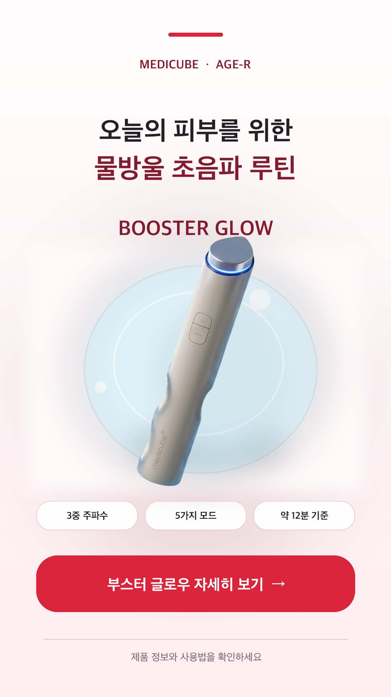
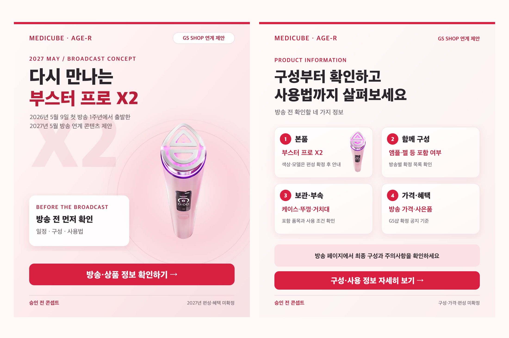
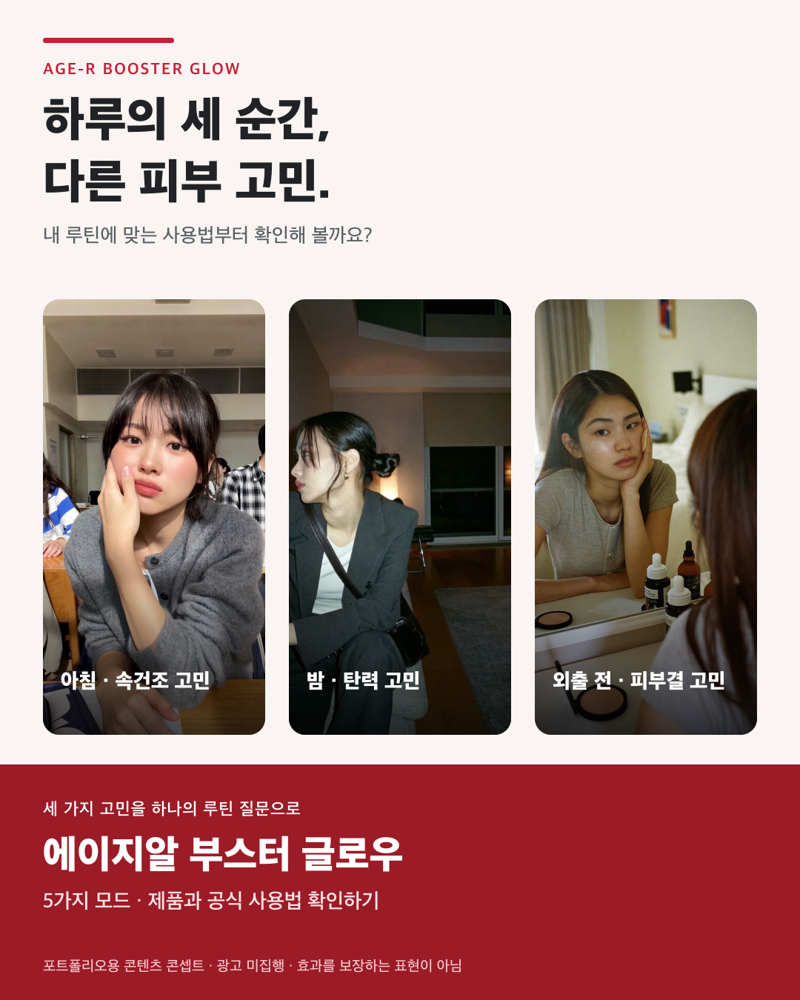
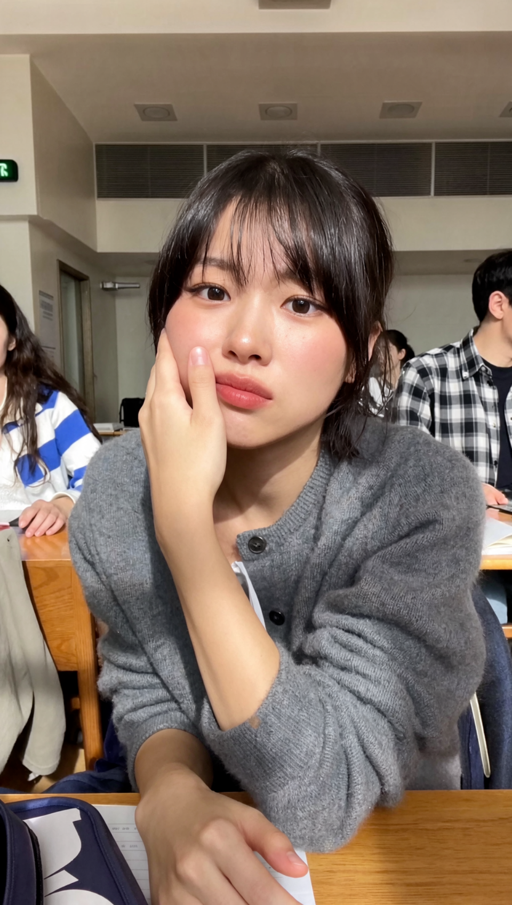
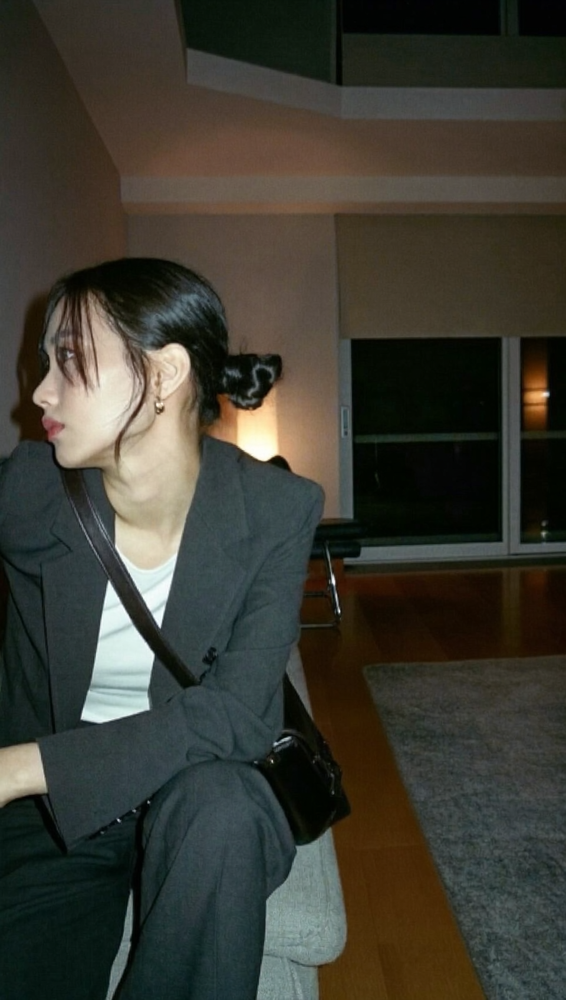
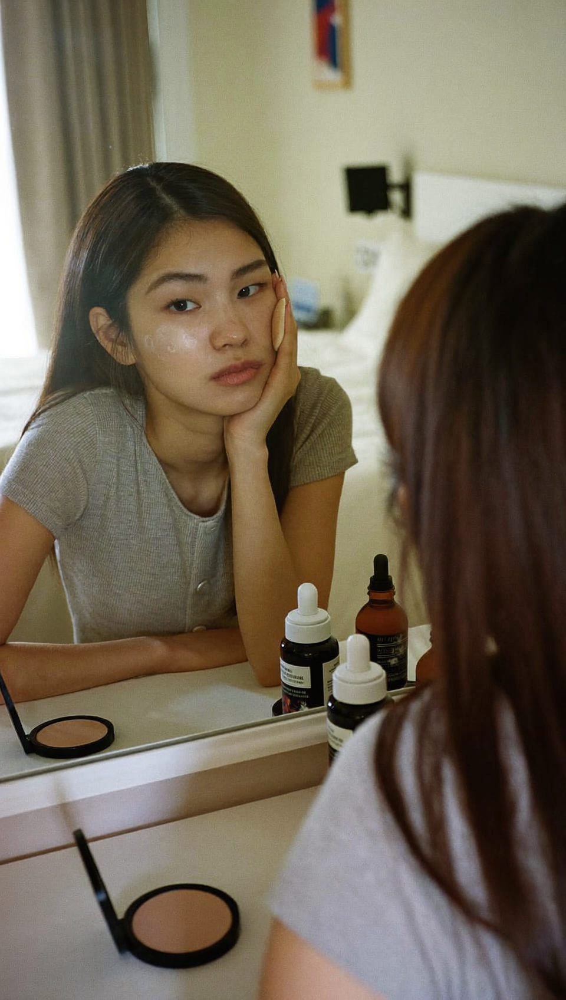
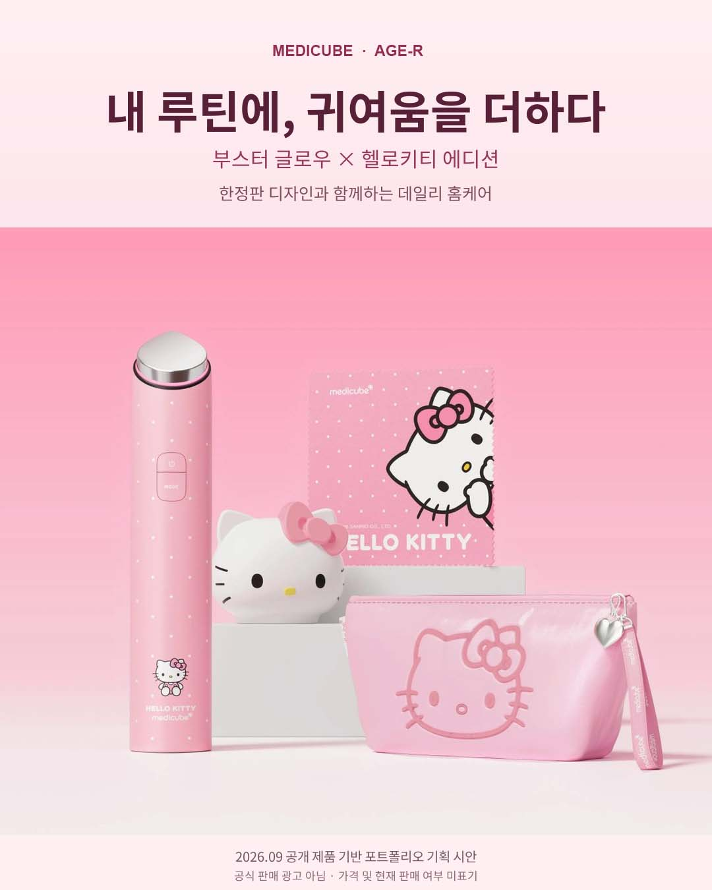
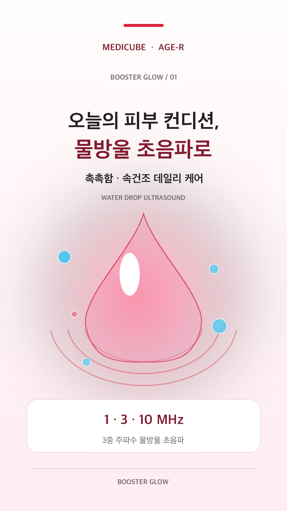
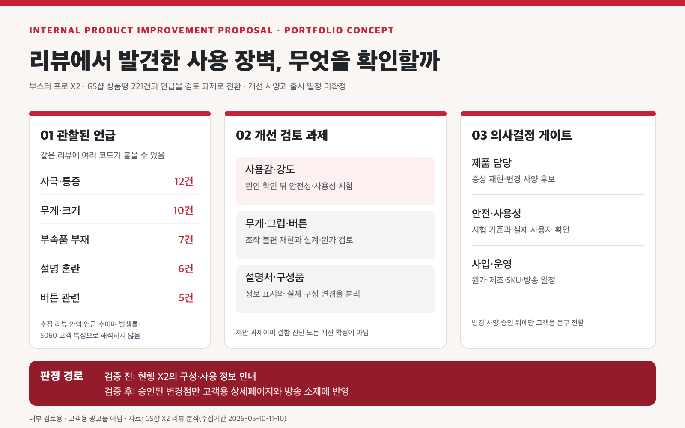

# 메디큐브 콘텐츠 마케팅 리서치 & 전략 포트폴리오

> **14쪽 에디토리얼 포트폴리오 · v0.2** · 최종 수정 2026-11-22 03:50 KST · 김윤서 · 2026.11 · 에이피알(APR) [마케팅 특별채용] 국내 콘텐츠 마케팅 신입 지원 (마감 2026-11-22 23:59)
>
> 이 문서는 `analysis/task2/build_portfolio.py`가 만들었고, 같은 스크립트가 같은 내용으로 `메디큐브_콘텐츠마케팅_포트폴리오.pdf`(14쪽)를 조판합니다. 수치는 저장소 현행 문서 값을 그대로 옮겼고, 설계 기준은 `메디큐브_콘텐츠마케팅_포트폴리오_구성안.md` v1.5입니다.

> **고정 문구(4·14쪽)** — *"공개 검색·클릭 지표와 수집 가능한 리뷰로 콘텐츠 및 채널 기회를 검토했다. 고객별 구매, 제품별 순매출, 광고 성과가 없어 타깃의 실제 구매 규모와 전략 효과는 판정하지 않았다."*

---

## 1쪽 · 표지

**CONTENT MARKETING PORTFOLIO**

v0.2 · 최종 수정 2026-11-22 03:50 KST

# 메디큐브 콘텐츠 마케팅 리서치 & 전략 포트폴리오

공개 데이터로 판단한 두 개의 축

| 구분 | 축 | 제작·실행 | 판정 |
|---|---|---|---|
| 01 | 2030 부스터 글로우 | 숏폼 30초 · 연계 포스터 · 자사몰 CRM | 콘텐츠 실험 1순위 조건부 채택 |
| 02 | 5060 GS샵 X2 | 홈쇼핑 1–2면 시안 · 내부 개선 기획안 | 방송 연계 조건부 설계 |

저장소 보고서 8편의 판단을 14쪽으로 압축하고, 그중 제작한 소재만 실었습니다.

- 지원 직무 — 에이피알(APR) [마케팅 특별채용] 국내 콘텐츠 마케팅 신입 · 마감 2026-11-22 23:59
- 작성 — 김윤서 · 숙명여자대학교 소프트웨어융합전공 · 2026.11
- 고지 — 숏폼 인물 클립·내레이션·포스터 연출 컷 일부는 생성형 AI로 제작(8·9·14쪽 표기). 실제 광고 집행·성과는 없습니다.

---

## 2쪽 · 프로필 & 핵심 역량

*이력이 이번 프로젝트에서 어떤 작업이 됐는지 한 줄씩 적었습니다.*

프로필 사진 자리 — [보완 예정] 지원자 확인 후 삽입

숙명여자대학교 소프트웨어융합전공 · 2025.08 졸업

팀스파르타 KDT 데이터 분석가 양성과정 · 2025.12–2026.05

**자격** SQLD 2025.04 · ADsP 2025.09 · 빅데이터분석기사 2026.07

> 지원 직무 — 에이피알(APR) [마케팅 특별채용] 국내 콘텐츠 마케팅 신입

### 이력 ↔ 이번 프로젝트에서 한 일

| 역량 | 이번 프로젝트에서 한 일 |
|---|---|
| 데이터 수집 | 네이버 데이터랩·쇼핑인사이트 원자료 13개, 구글 트렌드 CSV 13종, 올리브영 Top100 실측, 스니핏 10구간 27장을 직접 확보 |
| 검증·재계산 | 원자료 재계산 **141항목 불일치 0건**, MD↔PDF **8쌍** 본문 대조, 리뷰 **535건** 전수 코딩 |
| 경쟁 대조 | 메타 광고 라이브러리 **7개 브랜드** 실측, 경쟁사 원소재 고유·과장 표현 대조(중복 0건) |
| AI 영상·시안 | 30초 콘티 v1.2 설계, **AI 인물 클립 3개**, 홈쇼핑 1–2면 시안·3면 배치 SVG 제작 |
| 문서·조판 | 보고서 8편을 같은 CSS로 PDF화하고 MD↔PDF 본문을 대조, 이 포트폴리오도 코드로 조판 |

**데이터로 확인하고, **콘텐츠로 옮겼습니다.****

| 숫자 | 내용 |
|---|---|
| 141 | 원자료 재계산 항목 · 불일치 0건 |
| 535 | 리뷰 전수 코딩 건수 |
| 8 | 보고서 MD↔PDF 대조 쌍 |

> [AI 제작] 숏폼 인물 클립·내레이션·포스터 연출 컷은 생성형 AI로 만들었고, 범위는 8·9·14쪽에 적었습니다. [보완 예정] 프로필 사진과 최종 이력 항목은 지원자 확인 후 확정합니다.

---

## 3쪽 · 목차 + 프로젝트 개요

*조사 순서가 아니라 읽는 순서로 배열했습니다. 4쪽이 결론이고 5쪽부터가 근거입니다.*

| 쪽 | 제목 |
|---|---|
| 04 | 핵심 결론 한눈에 보기 |
| 05 | 시장 신호 — 국내·글로벌 |
| 06 | 2030·5060 타깃 선정 |
| 07 | 2030 글로우 제품 선정 |
| 08 | 2030 전략·콘티·CRM |
| 09 | 2030 제작물 |

| 쪽 | 제목 |
|---|---|
| 10 | 5060 채널·상품 선정 |
| 11 | 5060 내부 개선 기획안 |
| 12 | 5060 2027 방송 연계·CRM |
| 13 | 5060 홈쇼핑 1–2면 시안 |
| 14 | 한계·검증·부록 |

> **프로젝트 질문** — 공개 데이터만으로 메디큐브의 콘텐츠·채널 기회를 어디까지 판단할 수 있고, 그 판단을 어떤 콘텐츠로 실행할 수 있는가.

| 구간 | 내용 |
|---|---|
| 근거 | 5쪽 트렌드 / 6쪽 타깃 |
| 선택 | 7쪽 제품 / 10쪽 채널 |
| 실행 | 8–9쪽 2030 / 11–13쪽 5060 |
| 한계 | 14쪽 미판정 / 필요 데이터 |

### 자료 범위

| 자료 | 범위 |
|---|---|
| 네이버 데이터랩·쇼핑인사이트 | **데이터랩 54주·쇼핑인사이트 52주** · 브랜드 5사·5060 전용 5사·라인·디바이스 |
| 구글 트렌드 | **CSV 13종** · 미국·영국·일본 |
| 올리브영 Top100 | 실측 1회 · 2026-11-20 04:08 KST 저장 |
| 스니핏 | **10구간** 스크린숏 **27장** |
| 리뷰 535건 | 글로우 **232**(공식몰 217·글로우픽 15) + 글로우픽 미니 **82** + GS샵 X2 **221** |

### 이 문서의 세 가지 원칙

- **확인된 것과 판단한 것을 나눠 쓴다** — [관측]·[해석]·[실행 제안]·[제작물] 라벨을 쪽마다 붙였습니다.
- **없는 성과는 만들지 않는다** — 매출·ROAS·방송 효과는 판정하지 않고 미판정으로 남겼습니다.
- **검증은 다시 돌릴 수 있게** — 원자료 재계산과 MD↔PDF 대조를 저장소 스크립트로 재실행합니다.

> 공식몰 미니 200건은 미니 기존안 검토에만 써서 합산 735건입니다. 535건이 본문에 인용한 모집단입니다. [없는 자료] 매출·주문 로그, 광고 계정, 방문 로그는 4쪽 경계 문구와 14쪽 한계로 연결했습니다.

---

## 4쪽 · 핵심 결론 한눈에 보기

*이 쪽만 읽어도 무엇을 왜 기획했고, 무엇을 주장하지 않는지 남도록 썼습니다.*

**공개 근거로 **2030 부스터 글로우**와 **5060 GS샵 X2**, 두 축을 **조건부**로 기획했습니다.**

| 숫자 | 내용 |
|---|---|
| 28주 | 2030 글로우 · 같은 조건에서 미니 초과 |
| 221건 | GS샵 X2 리뷰 전수 코딩 |
| 0건 | 원자료 재계산 141항목 불일치 |

| 축 | 판단 | 제작·실행 |
|---|---|---|
| 01 · 2030 부스터 글로우 | 콘텐츠 실험 1순위 **조건부 채택** — 여성 19–39세·5/1 선출시 이후 28주 모두 미니 초과 | 숏폼 30초 · 연계 포스터 · 자사몰 CRM (8–9쪽) |
| 02 · 5060 GS샵 X2 | 방송 연계 **조건부 설계** — 첫 방송 2026-05-09, 상품평 221건 공개 | 홈쇼핑 1–2면 · 내부 개선안 · 배송 후 CRM (11–13쪽) |

**[CRM]** 2030은 비교 랜딩 이탈 고객에게 온사이트 배너·앱푸시를, 구매 후에는 루틴 정착 푸시를 붙였습니다. 5060은 배송 직후 사용법과 2주차 체감 안내를 스냅푸시·알림톡으로 설계했습니다.

> 이 문서에서 "조건부"란 검증 게이트를 통과할 때만 집행하는 제안입니다 — 7쪽 제품 채택, 11·13쪽 시안, 12쪽 편성안이 모두 해당하며 게이트를 통과하지 못하면 집행하지 않습니다.

> **미판정 경계** — 공개 검색·클릭 지표와 수집 가능한 리뷰로 콘텐츠 및 채널 기회를 검토했다. 고객별 구매, 제품별 순매출, 광고 성과가 없어 타깃의 실제 구매 규모와 전략 효과는 판정하지 않았다.

---

## 5쪽 · 시장 신호 — 국내·글로벌

*피크 5주 중 4주는 시장이 함께 오른 주였습니다. 메디큐브만의 상승으로 읽지 않았습니다.*

**피크 5주 중 **4주**는 경쟁사가 함께 올랐고, **8/3**만 디바이스 4사가 동시에 움직였습니다.**

| 숫자 | 내용 |
|---|---|
| 4주 | 피크 Top 5 중 경쟁사 동반 상승 |
| 8/3 | 디바이스 4사 동시 상승 주 |
| 35.1% | 영국 온라인 뷰티 내 아마존 UK |

[관측] 피크 Top 5주는 2026-11-02·08-03·05-04·03-02·06-29입니다. 11/02·03/02·05/04·06/29 네 주는 경쟁사가 함께 올랐고, 5/4 주의 상승은 한 해의 한 주 관측치라 시즌 효과로 확정하지 않습니다.

[해석] 경쟁 4사는 올리브영 세일가·1+1·어워즈 1위를 카피 앞머리에 두고 랜딩도 올리브영으로 보냅니다(메타 광고 라이브러리 **7개 브랜드** 실측 · 스니핏 **10구간 27장**). 메디큐브만 **디바이스+자사몰** 축이라, 콘텐츠를 세일 경쟁이 아니라 **디바이스 사용 상황·제품 이해**로 잡았습니다.

**글로벌** — 미국 1위 유지·영국 상승·일본 하락. 영국은 온라인 뷰티 45.5%·아마존 UK 35.1%·틱톡샵 9.8%, 일본은 Qoo10 25~30%입니다. 시점이 다른 값은 합산하지 않았고 채널 구성이 검색 추세의 원인이라고 단정하지 않았습니다.

> 상세 근거와 도표는 국내 트렌드 v1.6 · 글로벌 트렌드 v1.3 · 피크 주 대조 v1.5로 넘깁니다. 영국·일본 채널 비중의 기준 시점은 각각 2023-04까지 12개월·2025년·2025-03이며 서로 합산하지 않았습니다.

---

## 6쪽 · 2030·5060 타깃 선정

*두 타깃을 구매층이 아니라 콘텐츠 기회의 축으로 골랐습니다. 서로 다른 분모의 지표를 퍼널로 빼지 않았습니다.*

**2030은 **콘텐츠 실험 1순위**, 5060은 **사업상 탐색 타깃**입니다.**

| 타깃 | 관측 근거 — 도구·연령·비교군·기간 | 경계 |
|---|---|---|
| **2030** | 데이터랩 브랜드 검색 비중 **45.8%**(여성 19–39세·5개 브랜드·최근 13주·1위) · 쇼핑인사이트 스킨케어 클릭 **9.3%**(20·30대·5개 브랜드·4위) · 글로우픽 리뷰 **82건 중 74건(90.2%)**이 20·30대 표기 | 두 지표는 도구·연령 필터·분모가 달라 퍼널로 빼지 않음. **90.2%**는 수집 리뷰 안의 분포이며 전체 고객 연령 비중이 아님 |
| **5060** | 데이터랩 기기 검색 **5.6%**(5060 여성·5060 전용 5사·5위) · 쇼핑인사이트 이미용가전 클릭 **74.3%**(5개 키워드·1위) · 스킨케어 클릭 **6.5%**(4위, 1년 +5.3p.p.) | 도구·키워드·기간이 달라 퍼널 두 단계로 읽지 않음. **자사 매출 미확인**·X2 구매 우위 미판정 → 탐색 타깃으로만 표기 |

| 숫자 | 내용 |
|---|---|
| 45.8% | 2030 브랜드 검색 비중 · 데이터랩 5사 안 |
| 74.3% | 이미용가전 클릭 5060 · 5개 키워드 1위 |
| 90.2% | 글로우픽 미니 리뷰 20·30대 표기 |

**선정 기준 3개** — ① 공개 데이터로 관측이 가능한가 ② 콘텐츠로 실행할 형식이 있는가 ③ 확인되지 않은 것을 확인된 것처럼 쓰지 않고 설계할 수 있는가.

> 모든 비중은 **비교군 안의 몫**입니다 — 데이터랩 2025-11-03–2026-11-09 **54주**, 쇼핑인사이트 2025-11-03–2026-10-26 **52주**, 값은 각 계열 **최근 13주 평균**입니다. 5.6%와 74.3%는 도구·키워드가 달라 직접 비교하지 않습니다.

---

## 7쪽 · 2030 글로우 제품 선정

*미니 기존안을 보류하고 부스터 글로우를 콘텐츠 실험 1순위로 조건부 채택했습니다.*

**매출 주력도, 미니 대비 우위도 판정하지 않았습니다. **콘텐츠로 실험할 1순위**만 정했습니다.**

| 숫자 | 내용 |
|---|---|
| 28주 | 여성 19–39세 같은 조건 · 5/4–11/9 미니 초과 |
| 25주 | 상위 피크 3주 제외 후에도 모두 초과 |
| −24.6% | 최근 4주 평균 검색 · 판매량 아님 |

### 근거 1 — 같은 조건 검색 비교

여성 19–39세 동일 조회(**2026-05-04–11-09 28주**)에서 글로우는 출시 후 **28주 모두** 미니를 앞섰고, 상위 피크 3주를 빼도 **25주 모두** 앞섰습니다(합산 지수비 7.5 → 6.9, 최근 13주 9.5). 출시 전 4/20 첫 비영값을 쓰지 않고 **5/1 올리브영 선출시**에 맞춰 5/4 주부터 비교했습니다. 검색 지수이며 **판매량은 확인되지 않았습니다**.

### 근거 2 — 공식 정보·리뷰 대조로 소구 9개 추리기

| 판정 | 소구 |
|---|---|
| **채택** | 속건조 보습·물광(Shot 1·3) · 탄력 관리(Shot 2) · 고민별 5가지 모드(Shot 3·4) — 공식 5모드 기능 소구, 리프팅 단정 없음 |
| 조건부 | 매일 12분 홈케어 루틴(Shot 2·4) — 시술 대체 표현은 금지선 위반으로 제외 |
| 제외 | 민감 피부 진정 · 피부과 대체 경제성 · 임상 결과 신뢰성 · 저렴한 가격 소구 |

### 근거 3 — 반대 신호 처리

미니 리뷰의 휴대·여행 소구가 **57.5%**(공식몰 미니 리뷰 200건 CSV 태그 중 115건)로 확인돼 "가볍다·간편하다" 후킹은 주 후킹에서 보류했습니다. 최근 4주 검색 하락(**−24.6%**)도 지우지 않고 함께 적었습니다.

> **판정을 미룬 것** — 매출 주력 여부와 미니 대비 우위는 판정하지 않았습니다. 검색 지수는 판매량이 아니고 두 제품의 판매 자료가 없습니다. 미니 기존안은 폐기가 아니라 별도 태그 검토 대상으로 남겼습니다.

> 검색 지수는 **검색 관심도**이며 판매량이 아닙니다. 소구 채택은 메시지 효과 검증이 아니며, 글로우와 X2(10쪽)는 타깃·근거가 달라 같은 축에서 비교하지 않았습니다.

---

## 8쪽 · 2030 글로우 전략 · 콘티 v1.2 · CRM

*30초를 세 샷으로 나누고, 구매 전후 접점을 자사몰 CRM으로 이어 붙였습니다.*

**고민 1개 → 제품 이유 1개 → 자사몰 비교 랜딩. 구매 후에는 **하루 12분 루틴** 정착까지.**

| 구간 | 내용 |
|---|---|
| 0–7초 | 샷 1 · 아침 속건조 |
| 7–14초 | 샷 2 · 밤 탄력 |
| 14–21초 | 샷 3 · 외출 전 피부결 |
| 21–30초 | CTA · 자사몰 비교 랜딩 |

### 샷별 생성 방식과 검수

**샷 1 · Kling** — 속건조 → 물방울 초음파. 전후 비교·흡수율 % 단정 금지

**샷 2 · Higgsfield** — 야근 후 하루 12분. "피부과 안 가도" 금지

**샷 3 · Kling** — 뜨는 느낌 → 5가지 모드. 민감 진정·무자극 금지

**CTA · CapCut** — 가격·할인율 미표기, 자사몰 비교 랜딩 연결

### 자사몰 CRM — 비교 랜딩 이탈과 구매 후 정착

| 채널 | 메시지 | 발송 조건 |
|---|---|---|
| 온사이트 배너 | 내 피부 고민별 5가지 모드 가이드 — 속건조·탄력·물광 중 내 고민부터. 숏폼에서 보던 모드를 3분이면 확인합니다. | 비교 랜딩 이탈 · 앱 설치자 |
| 앱푸시 D+1 | 내 피부 고민별 5가지 모드 가이드 — 보던 모드 가이드, 앱에서 이어 보기. 고민별 5가지 모드를 3분 안에 비교합니다. | 랜딩 방문 · 미구매 |
| 앱푸시 구매 후 D+7 | 하루 12분 루틴(젤 크림 병행) — 오늘 루틴 한 번만 확인해 보세요. 젤 크림과 함께 쓰는 순서까지 안내합니다. | 구매 고객 · 루틴 정착 |

> **CRM 원칙** — 숏폼은 유입까지만 만듭니다. 이탈 지점에서 다시 부르고, 구매 뒤에는 루틴으로 붙잡는 것이 CRM의 몫입니다.

> [AI 제작] 인물 클립 3개(Kling 2·Higgsfield 1)와 7개 구간 내레이션(AI TTS)은 AI로 생성했습니다. 경쟁사 원소재 대비 표현 중복은 0건이며, 이 검수는 메시지 효과 검증이 아닙니다. 푸시 발송에는 자사몰 방문·구매 로그가 필요해 [실행 제안]이고 실제 발송·성과는 미집행입니다.

---

## 9쪽 · 2030 글로우 제작물

*포스터·엔드카드·헬로키티 에디션·브릿지 3종. 실제 제품 사진을 넣은 시안까지 만들었습니다.*

**[일부 제작] Shot 1–3 AI 생성 클립 + 29.8초 조립 초안 · 최종 시청·음성 검수 대기**

**숏폼 29.8초 · 1080×1920 · 30fps 조립 초안** — Shot 1–3 클립을 FFmpeg로 이어 붙였고 CapCut 최종 편집본은 아닙니다. 음성은 7개 구간 AI TTS, 배경 패드는 자체 제작입니다. 재생 링크·QR은 최종 시청·음성·권리 검수 뒤 넣습니다.

> 제품 사진 시안 3종은 저장소 `private_submission/`에 함께 들어 있습니다. 실제 광고 집행·성과는 없고, 제품 이미지 재사용 허락은 확인되지 않아 외부 게시에는 쓰지 않습니다.

---

## 10쪽 · 5060 GS샵 X2 채널·상품 선정

*5060의 X2 구매 비중과 홈쇼핑 이용률 통계는 확인되지 않았습니다. 공개 근거를 연결할 수 있는 채널로 GS샵을 먼저 골랐습니다.*

**공개 근거를 연결할 수 있어 GS샵 X2 방송 연계안을 먼저 설계했다.**

| 숫자 | 내용 |
|---|---|
| 2026-05-09 | GS샵 X2 첫 방송 · 단독 런칭 |
| 221건 | 상품평 수집 · 평점 4.6 |
| 10.0% | 선물·대리 구매 맥락 22건 |

| 항목 | 내용 |
|---|---|
| 첫 방송 | **2026-05-09** · [메디큐브] 부스터프로 시즌2 찬스쇼 단독 런칭 (핑크) · 상품번호 **1117330943** |
| 상품평 | **221건** · 수집 2026-05-10~2026-11-10 · 평점 **4.6** · 고유 ID 221건 대조 |
| 채널 대조 | CJ온스타일·롯데 — 메디큐브 X2 방송 이력 확인 수준까지 |

### 리뷰 221건 코딩에서 확인된 것 — 비중은 221건 표본 안의 몫

| 항목 | 값 |
|---|---|
| 선물·대리 구매 맥락 | **22건 (10.0%)** |
| 방송·찬스쇼를 구매 계기로 적은 리뷰 | **12건 (5.4%)** · 연령을 스스로 밝힌 리뷰 **3건 (1.4%)** |
| 색상 표기 | 핑크 **186건(84.2%)** · 화이트 16건(7.2%) · 미상 19건(8.6%) |
| 판단 유보 · 체감 없음 | **25건(11.3%)** · **10건(4.5%)** — 합 35건 |
| 구매 상품명 | **11종**으로 갈림 — 확정 SKU 1개 기준 구성표가 필요한 이유 |

> **쓰지 않는 문장** — 5060이 X2를 많이 구매했다.

> **쓰는 문장** — 공개 근거를 연결할 수 있어 GS샵 X2 방송 연계안을 먼저 설계했다.

> 모든 %는 GS샵 상품평 **221건**(2026-05-10–11-10 수집) 표본 안의 몫이며 발생률·5060 고객 특성으로 해석하지 않습니다. 221건과 핑크 페이지 구매 표시 848개를 나눠 작성률(약 26%)로 쓰던 문장은 분모 불일치로 폐기했습니다.

---

## 11쪽 · 5060 내부 개선 기획안 (3면 고도화)

*리뷰에서 확인된 사용 장벽을 고객 안내·구성·제품 검토 과제로 나눴습니다.*

**[내부 검토용] — 고객용 광고물 아님**

| 장벽 | 언급 | 검토 과제 |
|---|---|---|
| 자극·통증 | 12건 (5.4%) | 사용감·강도 — 원인 확인 뒤 안전성·사용성 시험 |
| 무게·크기 | 10건 (4.5%) | 무게·그립 — 조작 불편 재현과 설계·원가 검토 |
| 부속품 부재 | 7건 (3.2%) | 설명서·구성품 — 정보 표시와 실제 구성 변경을 분리 |
| 설명 혼란 | 6건 (2.7%) | 설명서·구성품 — 표시 방식 검토 |
| 버튼 관련 | 5건 (2.3%) | 버튼 — 위치·조작 설계 검토 |

> [내부 검토용] 고객 안내로 풀 수 있는 것 · 구성·설명서로 풀 수 있는 것 · **제품 변경 검토가 필요한 것**을 나눈 조건부 제안서 요약입니다. 제품 검증 완료·출시 확정·시험 결과를 주장하지 않으며, 원인·안전성·원가 검증은 미실시입니다. 원문 기획안 전체는 14쪽 저장소 링크로 넘깁니다.

---

## 12쪽 · 5060 2027년 5월 방송 연계 · CRM

*첫 방송 1주년에 맞춘 재방송 연계안입니다. 편성·혜택은 협의 목표일 뿐 확정이 아닙니다.*

**재방송은 편성이 아니라 **고객 안내 설계**부터 — 배송 직후 사용법, 2주차 체감 안내.**

| 구간 | 내용 |
|---|---|
| 2026-05-09 | GS샵 첫 방송 · X2 단독 런칭 |
| 2026-11 | 상품평 221건 수집·코딩 |
| 2027-05-08–09 전후 | 1주년 재방송 · 협의 목표일 |
| 2027-05 이후 | 전용 코드·회차별 주문 비교 |

**검증 게이트 3개** — ① GS샵 방송 ID·SKU·연령별 순주문·순매출 확인 ② APR 제품 담당의 개선 가능성·시험·제조 일정 확인 ③ 방송 편성·혜택 협의. 셋을 통과할 때만 집행합니다.

### 배송 후 CRM — 스냅푸시·알림톡 2단계

| 채널 | 메시지 | 발송 조건 |
|---|---|---|
| 스냅푸시 · 알림톡 D+0 | 큰 글씨 사용법 + 손잡이 아래쪽 그립 팁 — 손잡이는 아래쪽을 잡으면 버튼이 덜 눌립니다. 사용 전 확인할 3가지를 큰 글씨로 안내합니다. | 배송 완료 직후 · 구매 고객 |
| 알림톡 D+14 | 피부 상태별 체감 안내 — 사용 2주, 체감 시기와 강도는 피부 상태에 따라 다릅니다. 단계별 사용 강도를 안내합니다. | 배송 2주차 · 구매 고객 |

> 근거는 GS샵 상품평 221건 표본 — 버튼 **5건(2.3%)** · 설명서 **6건(2.7%)** · 자극 **12건(5.4%)** · 판단 유보 25건·체감 없음 10건(합 **35건**)입니다. 2027년 편성·혜택·매출 목표는 미확정이고, 발송에는 GS샵 주문·회차 자료가 필요해 [실행 제안]입니다.

---

## 13쪽 · 5060 홈쇼핑 1–2면 시안

*기존 3면 시안 중 앞의 1–2면을 실제 광고 페이지 수준으로 올린 작업입니다.*

**[승인 전 콘셉트] — 제품 변경·출시·편성 확정으로 읽히는 문구는 넣지 않았습니다**

### 1면 · 방송 전 예고

재방송 맥락 → 제품 인지 → 구성 확인 → 일정·랜딩 순서로 읽히게 설계했습니다. 확정 방송일·승인된 URL만 넣고, 2027-05-09를 확정 방송일로 쓰지 않습니다.

### 2면 · 구성 확인 카드

**본품 → 함께 구성 → 보관·부속 → 가격·혜택** 4항목으로 나눴습니다. 확정 SKU 1개 기준 구성표로 고정해 SKU마다 구성이 달라지는 상황을 막습니다.

> **승인 전 콘셉트** — 제품 변경·출시·편성 확정으로 읽히는 문구는 넣지 않았습니다. 공식몰·GS샵 상세페이지의 디자인·문구·사진을 복사하거나 재편집하지 않았고, 확인되지 않은 혜택·수치·랭킹도 넣지 않았습니다. 시안 파일은 저장소 `private_submission/5060/`에 포함되어 있으며, 제품 이미지 재사용 허락은 확인되지 않아 광고 집행·외부 게시에는 쓰지 않습니다.

---

## 14쪽 · 한계, 검증 데이터 & 역할·부록

*주장하지 않은 것을 먼저 적었습니다. 검증 수치는 저장소에서 다시 실행해 확인할 수 있습니다.*

> **미판정 경계** — 공개 검색·클릭 지표와 수집 가능한 리뷰로 콘텐츠 및 채널 기회를 검토했다. 고객별 구매, 제품별 순매출, 광고 성과가 없어 타깃의 실제 구매 규모와 전략 효과는 판정하지 않았다.

**[미확인]** GS샵 연령별 순주문·제품 개선 일정·2027년 편성 — 10·11·12쪽 판정 유보 사유입니다. 성과 판정에 필요한 자료는 GS샵 **방송 ID·SKU·연령별 순주문·순매출**, 자사몰·광고 채널의 **방문·전환·광고비**, 제품 **개선 사양·시험·생산 일정**입니다.

| 숫자 | 내용 |
|---|---|
| 141 | 원자료 재계산 항목 · 불일치 0건 |
| 8 | MD↔PDF 본문 대조 쌍 · 빈 쪽 0 |
| 535 | 리뷰 전수 코딩 건수 |

| 검증 항목 | 결과 |
|---|---|
| 원자료 재계산 | **141항목 불일치 0건** (verify2.py --numeric-only) |
| MD↔PDF 본문 대조 | **8쌍** 통과 · 입력·출력 해시 확인 · 빈 쪽 0 (verify_pdf_sync.py) |
| 리뷰 코딩 | **535건** 전수 코딩 (글로우 232 · 미니 82 · GS샵 X2 221) |
| GS샵 리뷰 대조 | **221건** 고유 ID·평점 분포 대조 |

**역할·도구** — 문제 정의·데이터 수집·재계산 검증·리뷰 코딩·경쟁 표현 검수·콘티 설계·시안 제작(SVG)·PDF 조판(Python)을 직접 했습니다. **Kling·Higgsfield 영상, AI TTS 내레이션, 포스터 연출 컷은 AI로 생성**했고, 도구는 생성·렌더링에만 쓰고 판단·검수는 직접 했습니다.

### 부록 — 전체 보고서 8편

| 보고서 | 저장소 경로 |
|---|---|
| 국내 타깃·가설 v2.9 | `reports/메디큐브_국내_타깃가설_마케팅전략.md` |
| 글로우 2030 전략 연결 v2.2 | `reports/메디큐브_글로우_리뷰분석_2030전략연결.md` |
| GS샵 X2 리뷰 분석 v0.2 | `reports/메디큐브_GS샵_X2_리뷰분석.md` |
| X2 2027 프로모션 기획서 v0.3 | `reports/메디큐브_GS샵_X2_2027_5월_프로모션기획서.md` |
| X2 2027 정적 스토리보드 v0.3 | `reports/메디큐브_GS샵_X2_2027_5월_정적스토리보드.md` |
| 국내 트렌드 v1.6 | `reports/메디큐브_국내_트렌드_분석보고서.md` |
| 글로벌 트렌드 v1.3 | `reports/메디큐브_글로벌_트렌드_분석보고서.md` |
| 국내 피크 주 대조 v1.5 | `reports/메디큐브_국내_피크주_광고_이벤트_대조분석.md` |

> [AI 제작] 1·2·8·9쪽에 표기한 숏폼 인물 클립 3개·7개 구간 내레이션·포스터 연출 컷은 생성형 AI 산출물이며, 실제 촬영·성우 녹음·광고 집행은 없습니다. 저장소 github.com/rladbstj56/medicube_marketing(비공개) · 검증 스크립트 analysis/task2/verify2.py · verify_pdf_sync.py · verify_portfolio.py · 리뷰 코딩표 data/reviews/.

---
