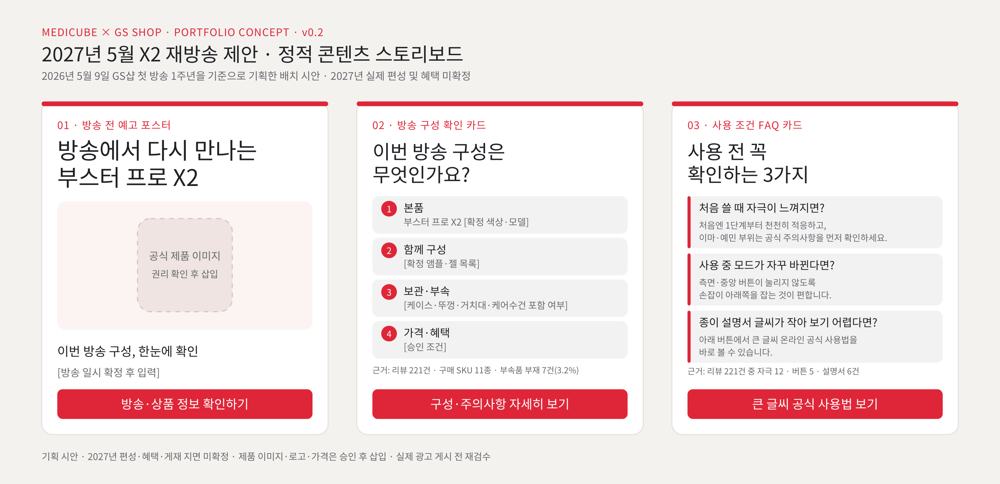
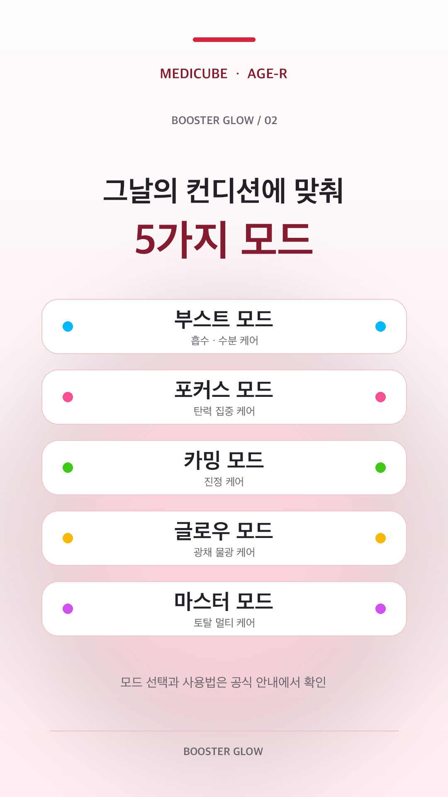
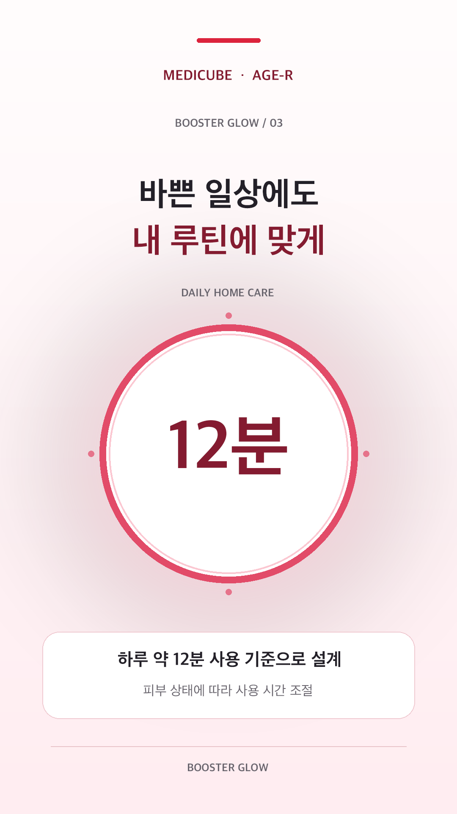
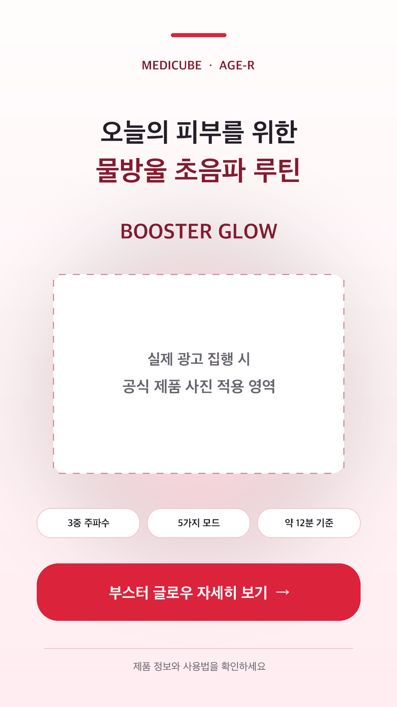

# 메디큐브 콘텐츠 마케팅 리서치 & 전략 포트폴리오

> **14쪽 두괄식 포트폴리오 · v0.1(1차본)** · 최종 수정 2026-11-22 02:10 KST · 김윤서 · 2026.11 · 에이피알(APR) [마케팅 특별채용] 국내 콘텐츠 마케팅 신입 지원 (마감 2026-11-22 23:59)
>
> 이 문서는 `analysis/task2/build_portfolio.py`가 만들었고, 같은 스크립트가 같은 내용으로 `메디큐브_콘텐츠마케팅_포트폴리오.pdf`(14쪽)를 조판합니다. 수치는 저장소 현행 문서 값을 그대로 옮겼고, 설계 기준은 `메디큐브_콘텐츠마케팅_포트폴리오_구성안.md` v1.2입니다.

> **고정 문구(4·14쪽)** — *"공개 검색·클릭 지표와 수집 가능한 리뷰로 콘텐츠 및 채널 기회를 검토했다. 고객별 구매, 제품별 순매출, 광고 성과가 없어 타깃의 실제 구매 규모와 전략 효과는 판정하지 않았다."*

---

## 1쪽 · 표지

**CONTENT MARKETING PORTFOLIO · 2026.11**

# 메디큐브 콘텐츠 마케팅 리서치 & 전략 포트폴리오

공개 데이터로 판단한 두 축

- **01 2030 부스터 글로우** — 숏폼 30초 · 연계 포스터 — 콘텐츠 실험 1순위 조건부 채택
- **02 5060 GS샵 X2** — 홈쇼핑 1–2면 시안 · 내부 개선 기획안 — 방송 연계 조건부 설계

| 항목 | 내용 |
|---|---|
| 지원 직무 | 에이피알(APR) [마케팅 특별채용] 국내 콘텐츠 마케팅 신입 |
| 작성자 | 김윤서 |
| 작성 시점 | 2026.11 |
| 문서 버전 | v0.1 · 1차본 (최종 수정 2026-11-22 02:10 KST) |
| AI 제작 | 숏폼 인물 클립·내레이션·포스터 연출 컷 일부 AI 생성 (8·9·14쪽 표기) |
| 제출 마감 | 2026-11-22 23:59 |

> 이 문서는 실제 광고·방송을 집행한 성과가 아니라, 공개 근거로 판단하고 소재로 옮긴 과정을 정리한 것입니다. 매출·ROAS·방송 효과는 주장하지 않으며, 모든 판단에는 [관측]·[해석]·[실행 제안]·[제작물] 라벨을 붙였습니다. 숏폼 인물 클립·내레이션·포스터 연출 컷 등 AI로 생성한 소재는 쪽마다 AI 제작 표기를 붙였습니다.

---

## 2쪽 · 프로필 & 핵심 역량

*이력과 자격이 이번 프로젝트에서 어떤 작업으로 이어졌는지 1:1로 적었습니다.*

프로필 사진 자리 — [보완 예정] 지원자 확인 후 삽입

**김윤서**

숙명여자대학교 소프트웨어융합전공 · 2025.08 졸업

팀스파르타 KDT 데이터 분석가 양성과정 · 2025.12–2026.05

**자격** SQLD 2025.04 · ADsP 2025.09 · 빅데이터분석기사 2026.07

> 지원 직무 — 에이피알(APR) [마케팅 특별채용] 국내 콘텐츠 마케팅 신입

| 이력·역량 | 이번 프로젝트에서 한 일 |
|---|---|
| 데이터 수집 | 네이버 데이터랩·쇼핑인사이트 원자료 13개(데이터랩 9·쇼핑인사이트 4), 구글 트렌드 CSV 13종, 올리브영 Top100 실측, 스니핏 10구간 스크린숏을 직접 확보 |
| 검증·재계산 | 원자료 재계산 **141항목 불일치 0건**, MD↔PDF **8쌍** 본문 대조, 리뷰 **535건** 전수 코딩 |
| 경쟁 대조 | 메타 광고 라이브러리 **7개 브랜드** 실측, 경쟁사 원소재 고유·과장 표현 대조(중복 0건) |
| AI 영상·시안 기획 | 30초 콘티 v1.2 설계, **Kling·Higgsfield로 AI 생성한 인물 클립 3개**, **AI TTS 내레이션 7구간**, 홈쇼핑 정적 시안·3면 배치 SVG 제작 |
| 문서·조판 | 보고서 8편을 같은 CSS로 PDF화하고 MD↔PDF 본문을 대조, 이 포트폴리오도 코드로 조판 |

> [AI 제작] 숏폼 인물 클립·내레이션·포스터 연출 컷은 생성형 AI로 만들었고, 8·9·14쪽에 범위를 적었습니다.

### 이 프로젝트에서 남긴 검증 숫자

| 숫자 | 내용 |
|---|---|
| 141 | 원자료 재계산 항목 · 불일치 0건 |
| 8 | 보고서 MD↔PDF 대조 쌍 |
| 535 | 리뷰 전수 코딩 건수 |
| 13 | 구글 트렌드 CSV 세트 |

> **이 포트폴리오의 작업 원칙**
>
> **① 확인된 것과 판단한 것을 나눠 쓴다** — [관측]·[해석]·[실행 제안]·[제작물] 라벨을 쪽마다 붙였습니다.
>
> **② 없는 성과는 만들지 않는다** — 매출·ROAS·방송 효과는 판정하지 않고 미판정으로 남겼습니다.
>
> **③ 검증은 다시 돌릴 수 있게** — 원자료 재계산과 MD↔PDF 대조를 저장소 스크립트로 재실행할 수 있습니다.
>

> [보완 예정] 프로필 사진과 최종 이력서 항목은 지원자 확인 후 확정합니다.

---

## 3쪽 · 목차 + 프로젝트 개요

*조사 순서가 아니라 읽는 순서로 배열했습니다. 4쪽이 결론이고 5쪽부터가 근거입니다.*

### 목차 — 4~14쪽

- **4** 핵심 결론 한눈에 보기
- **5** 국내·글로벌 트렌드 핵심 요약
- **6** 2030·5060 타깃 선정 근거
- **7** 2030 글로우 제품 선정 근거
- **8** 2030 글로우 전략 & 콘티 v1.2
- **9** 2030 글로우 제작물

- **10** 5060 GS샵 X2 채널·상품 선정 근거
- **11** 5060 내부 개선 기획안(3면 고도화)
- **12** 5060 2027년 5월 방송 연계 기획
- **13** 5060 홈쇼핑 메인·상세페이지 시안
- **14** 한계, 검증 데이터 & 역할·부록

| 구간 | 내용 |
|---|---|
| 근거 | 5쪽 트렌드 / 6쪽 타깃 |
| 선택 | 7쪽 제품 / 10쪽 채널 |
| 실행 | 8–9쪽 2030 / 11–13쪽 5060 |
| 한계 | 14쪽 미판정 / 필요 데이터 |

> **프로젝트 질문**
>
> 공개 데이터만으로 메디큐브의 콘텐츠·채널 기회를 어디까지 판단할 수 있고, 그 판단을 어떤 콘텐츠로 실행할 수 있는가.
>

### 자료 범위

| 자료 | 범위 |
|---|---|
| 네이버 데이터랩·쇼핑인사이트 | **데이터랩 54주·쇼핑인사이트 52주** · 브랜드 5사·5060 전용 5사·라인·디바이스 |
| 구글 트렌드 | **CSV 13종** · 미국·영국·일본 |
| 올리브영 Top100 | 실측 1회 · 2026-11-20 04:08 KST 저장 |
| 스니핏 | **10구간** 스크린숏 **27장** |
| 리뷰 535건 | 글로우 **232**(공식몰 217·글로우픽 15) + 글로우픽 미니 **82** + GS샵 X2 **221** |

> 공식몰 미니 200건은 미니 기존안 검토에만 써서 합산 735건입니다. 535건은 본문에 인용한 모집단입니다.

### 만드는 순서 — 수집에서 조판까지

| 구간 | 내용 |
|---|---|
| 수집 | 원자료 / 직접 확보 |
| 코딩 | 리뷰 535건 / 전수 코딩 |
| 재계산 | 141항목 / 불일치 대조 |
| 검수 | 표현·경계 / 문구 검토 |
| 조판 | MD↔PDF / 본문 대조 |

[없는 자료] 매출·주문 로그, 광고 계정, 방문 로그 — 4쪽 경계 문구와 14쪽 한계로 연결했습니다.

---

## 4쪽 · 핵심 결론 한눈에 보기

*이 쪽만 읽어도 무엇을 왜 기획했고, 무엇을 주장하지 않는지 남도록 썼습니다.*

> 공개 근거로 **2030 부스터 글로우(숏폼·포스터)** 와 **5060 GS샵 X2(홈쇼핑 시안·내부 개선안)** 두 축을 **조건부**로 기획했습니다.
>

> **이 문서에서 "조건부"란**
>
> 검증 게이트를 통과할 때만 집행하는 제안입니다. 7쪽 제품 채택, 11·13쪽 5060 시안과 개선안, 12쪽 편성안이 모두 여기에 해당하며, 게이트를 통과하지 못하면 집행하지 않습니다.
>

| 구간 | 내용 |
|---|---|
| 4쪽 | 결론 |
| 5–6쪽 | 근거와 타깃 |
| 7–9쪽 | 2030 실행 |
| 10–13쪽 | 5060 실행 |
| 14쪽 | 한계와 부록 |

> **미판정 경계**
>
> 공개 검색·클릭 지표와 수집 가능한 리뷰로 콘텐츠 및 채널 기회를 검토했다. 고객별 구매, 제품별 순매출, 광고 성과가 없어 타깃의 실제 구매 규모와 전략 효과는 판정하지 않았다.
>

---

## 5쪽 · 국내·글로벌 트렌드 핵심 요약

*피크 5주 중 4주는 시장이 함께 오른 주였습니다. 메디큐브만의 상승으로 읽지 않았습니다.*

| 숫자 | 내용 |
|---|---|
| 4주 | 피크 Top 5 중 경쟁사 동반 상승 |
| 8/3 | 디바이스 4사 동시 상승 주 |
| 35.1% | 영국 온라인 뷰티 내 아마존 UK (2023-04까지 12개월) |
| 25~30% | 일본 온라인 뷰티 내 Qoo10 (2025-03·2026 발표) |

[관측] 피크 Top 5주(2026-11-02·08-03·05-04·03-02·06-29) 중 11/02·03/02·05/04·06/29 네 주는 경쟁사가 함께 오른 주이고, 8/3만 디바이스 4사가 동시에 움직인 주입니다.

[해석] 시장이 함께 오른 주를 메디큐브만의 상승으로 읽지 않았습니다. 5/4 주의 상승은 한 해의 한 주에 대한 관찰치이므로 시즌 효과로 확정하지 않습니다.

### 전략적 시사점 — 왜 디바이스 중심인가

- 경쟁 4사는 **올리브영 세일가·1+1·어워즈 1위**를 카피 앞머리에 두고 랜딩도 올리브영으로 보냅니다(메타 광고 라이브러리 **7개 브랜드** 실측 · 스니핏 **10구간 27장**, 2026-11-20).
- 메디큐브만 **디바이스+자사몰** 축으로 움직입니다.
- 그래서 콘텐츠를 세일 경쟁이 아니라 **디바이스 사용 상황·제품 이해**로 잡았습니다 — 이 쪽의 판단은 모두 그 실측에 기댑니다.

### 글로벌 — 세 방향과 채널 구조

미국 1위 유지·영국 상승·일본 하락의 세 방향을 채널 구조와 함께 봤습니다. 영국은 뷰티 소비의 45.5%가 온라인(**2025년** 영국 뷰티 시장 기준)이고 그 온라인의 35.1%가 아마존 UK(**2023-04까지 12개월** 온라인 뷰티 매출 점유)·틱톡샵 9.8%(**2025년 누계**)이며, 일본은 화장품 이커머스 비중이 10% 미만(**2026-04 보도**, E85)이고 그 온라인의 1위가 Qoo10(25~30%, **2025-03 베인·2026 자사 발표**)입니다. 시점이 다른 값은 합산하지 않았고, 채널 구성이 검색 추세의 원인이라고 단정하지 않았습니다.

> 국내 본문에서는 글로벌을 1~2문장으로만 쓰고, 상세는 글로벌 트렌드 보고서(v1.3)로 넘깁니다.

---

## 6쪽 · 2030·5060 타깃 선정 근거

*두 타깃을 구매층이 아니라 콘텐츠 기회의 축으로 골랐습니다. 서로 다른 분모의 지표를 퍼널로 빼지 않았습니다.*

| 구분 | 판단 기준 | 관측 근거 — 도구·연령·비교군·기간 | 경계 |
|---|---|---|---|
| **2030** | 검색 관심과 리뷰에서 콘텐츠 질문을 구체화할 수 있는 축 — **콘텐츠 실험 1순위 조건부 채택** | 데이터랩 브랜드 검색 비중 **45.8%**(여성 19–39세·5개 브랜드 안·54주 중 최근 13주·1위) · 쇼핑인사이트 스킨케어 클릭 **9.3%**(20·30대·스킨케어 5개 브랜드 안·52주 중 최근 13주·4위) · 글로우픽 리뷰 **82건 중 74건(90.2%)**이 20·30대 표기 | 두 지표는 도구·연령 필터·분모가 달라 퍼널로 빼지 않음. **90.2%**는 수집 리뷰 82건 안의 분포이며 전체 고객 연령 비중이 아님 |
| **5060** | **사업상 탐색 타깃** — 공개 근거를 연결할 수 있는 축(구매층 아님) | 데이터랩 기기 검색 **5.6%**(5060 여성·5060 전용 5사 안·54주 중 최근 13주·5위) · 쇼핑인사이트 이미용가전 클릭 **74.3%**(5060 여성·5060 전용 5개 키워드 안·52주 중 최근 13주·1위) · 스킨케어 클릭 **6.5%**(5060 여성·5060 전용 5사 안·52주 중 최근 13주·4위, 1년 +5.3p.p.) · 실장님 인터뷰의 "5060 고객 유입" 과제가 출발점 | 도구·키워드·기간이 달라 두 값을 퍼널 두 단계로 읽지 않음. **자사 매출 미확인**·X2 구매 우위 미판정 → 사업상 탐색 타깃으로만 표기 |

| 숫자 | 내용 |
|---|---|
| 45.8% | 2030 브랜드 검색 비중 · 데이터랩 5사 안 |
| 9.3% | 스킨케어 클릭 2030 · 쇼핑인사이트 5사 |
| 5.6% | 5060 기기 검색 · 5060 전용 5사 5위 |
| 74.3% | 이미용가전 클릭 5060 · 5개 키워드 1위 |

### 선정 기준 3개

① 공개 데이터로 **관측이 가능한가** ② 콘텐츠로 **실행할 형식이 있는가** ③ 확인되지 않은 것을 확인된 것처럼 쓰지 않고 **설계할 수 있는가**.

| 타깃 | 콘텐츠 실행 형식 | 판정 상태 |
|---|---|---|
| 2030 | 숏폼 30초 · 연계 포스터 (8–9쪽) | 콘텐츠 실험 1순위 **조건부 채택** |
| 5060 | 홈쇼핑 1–2면 시안 · 내부 개선 기획안 (11·13쪽) | 방송 연계 **조건부 설계** |

> 모든 비중은 **비교군 안의 몫**입니다 — 데이터랩 2025-11-03–2026-11-09 **54주**, 쇼핑인사이트 2025-11-03–2026-10-26 **52주**, 값은 각 계열 **최근 13주 평균**입니다. 5060은 구매층이 아니라 **탐색 타깃**이며, 5.6%와 74.3%는 도구·키워드가 달라 직접 비교하지 않습니다.

---

## 7쪽 · 2030 글로우 제품 선정 근거

*미니 기존안을 보류하고 부스터 글로우를 콘텐츠 실험 1순위로 조건부 채택했습니다.*

> 매출 주력 여부와 미니 대비 우위는 판정하지 않았습니다. **콘텐츠로 실험할 1순위**만 정했습니다.
>

| 숫자 | 내용 |
|---|---|
| 28주 | 여성 19–39세 같은 조건 · 5/4–11/9 미니 초과 |
| 25주 | 상위 피크 3주 제외 후에도 모두 초과 |
| 7.5 → 6.9 | 28주·25주 합산 지수비 · 최근 13주 9.5 |
| −24.6% | 최근 4주(10/19–11/9) 평균 검색 · 판매량 아님 |

### 근거 1 — 같은 조건 검색 비교

여성 19–39세 동일 조회(**2026-05-04–11-09 28주**)에서 글로우는 출시 후 **28주 모두** 미니를 앞섰고, 상위 피크 3주를 빼도 **25주 모두** 앞섰습니다. 출시일은 출시 전 4/20 첫 비영값을 쓰지 않고 **5/1 올리브영 선출시**에 맞춰 **5/4 주부터** 비교했습니다. 검색 지수이며 **판매량은 확인되지 않았습니다**.

### 근거 2 — 공식 정보·리뷰 대조로 소구 9개 추리기

공식 비교표·FAQ·상세 이미지로 물방울 초음파·**170g**·**5모드**·**12분** 루틴을 확인하고, 공식몰 키워드 **O01–O12**와 리뷰 주제 **R01–R06**을 대조했습니다.

| 판정 | 소구 후보 | 적용 | 근거 |
|---|---|---|---|
| **채택** | 1·3. 속건조 보습 + 푸석함 물광 | Shot 1·3 | O03 + R01(37건)·R03(42건)·R02(24건) |
| **채택** | 2. 탄력 관리 | Shot 2 | 리뷰 건수 집계가 아니라 공식 5모드(**포커스 모드** 포함) 기능 소구 + 30대 직장인 상황 연결 · 리프팅 단정 없음 |
| **채택** | 5. 고민별 5가지 모드 | Shot 3·4 | 서로 다른 2030 고민을 한 기기로 묶는 근거(O04·O06) |
| 조건부 | 7. 매일 12분 홈케어 루틴 | Shot 2·4 | O10 + R05 · 시술 대체 표현은 금지선 위반으로 제외 |
| 제외 | 4. 민감 피부 밸런싱·진정 | — | R06 중단 사례 · 무자극 단정 금지와 충돌 |
| 제외 | 6. 비싼 피부과 대체 경제성 | — | 시술 대체 표현 금지선과 직접 충돌 |
| 제외 | 8. 임상 결과 신뢰성 | — | 임상 원문·피험자·수치 조건 전수 검수 미완료 |
| 제외 | 9. 저렴한 가격 소구 | — | 리뷰의 가격 부담과 충돌 · 가격은 랜딩에 위임 |

### 근거 3 — 반대 신호 처리

미니 리뷰에서 휴대·여행 소구가 **57.5%**(공식몰 미니 리뷰 200건 CSV 태그 중 115건)로 확인돼, 글로우를 "가볍다·간편하다"로 파는 후킹은 주 후킹에서 보류했습니다. 검색 하락(여성 19–39세·최근 4주 10/19–11/9 평균 **−24.6%**)도 지우지 않고 함께 적었습니다.

> **판정을 미룬 것**
>
> **매출 주력 여부 · 미니 대비 우위** — 검색 지수는 판매량이 아니고 두 제품의 판매 자료가 없습니다.
>
> **미니 기존안 폐기** — 미니는 별도 태그 검토 대상으로 남겼고, 추출 기준 적합성은 미확인입니다.
>

> 검색 지수는 **검색 관심도**이며 판매량이 아닙니다. 소구 채택은 메시지 효과 검증이 아닙니다. 글로우와 X2(10쪽)는 타깃·근거가 달라 같은 축에서 비교하지 않았습니다.

---

## 8쪽 · 2030 글로우 전략 & 콘티 v1.2

*30초를 고민 1개 → 제품 이유 1개 → 자사몰 비교 랜딩의 세 샷과 CTA로 나눴습니다.*

**[왜 숏폼인가]** ① 메타 광고 라이브러리 **7개 브랜드** 실측에서 경쟁사 주력 소재가 동영상·릴스형이고 메디큐브도 동영상+정적 혼합입니다. ② 지원 직무가 숏폼 제작과 자사몰 연결을 요구합니다. ③ 글로우 5모드·12분 루틴이 아침 강의실·퇴근길·거울 앞 상황 컷에 맞습니다. CTR·전환은 **미집행 파일럿 실험 대상**이며, 이 쪽은 소재 설계와 검수까지입니다.

### 30초 구조

| 구간 | 내용 |
|---|---|
| 0–7초 | 샷 1 · 아침 속건조 |
| 7–14초 | 샷 2 · 밤 탄력 |
| 14–21초 | 샷 3 · 외출 전 피부결 |
| 21–30초 | CTA · 자사몰 비교 랜딩 |

### 컷별 설계 — 고민 1개와 제품 이유 1개

| 시간 | 상황 | 고민 → 훅 | 검수 지시 |
|---|---|---|---|
| 0–7초 | 20대 · 강의실 아침 | "기초 바른 지 얼마나 됐다고 속건조가…" → 물방울 초음파 | O02·O03·R01·R04 · 전후 비교·흡수율 % 단정 금지 |
| 7–14초 | 30대 · 퇴근길 거실 | "야근이라 관리할 시간도 없네…" → 집에서 하루 12분 | O06·O10·R05 · "피부과 안 가도" 금지 |
| 14–21초 | 20대 · 화장실 거울 | "뭘 발라도 뜨는 느낌" → 5가지 모드 | O04·O06·R02·R03 · 민감 진정·무자극 금지 |
| 21–30초 | 모션 타이포 CTA | 속건조·탄력·물광 → 5가지 모드 · 하루 12분 | O11 · 가격·할인율 미표기 · 자사몰 비교 랜딩 |

### 샷별 생성 방식과 검수 포인트

| 샷 | 생성 도구 | 검수 포인트 |
|---|---|---|
| 샷 1 | Kling | 표정·제스처만 생성 · 립싱크 없음 · 전후 비교 금지 |
| 샷 2 | Higgsfield | 12분 시계 그래픽 · 30초 안에 관리가 끝나는 연출 금지 |
| 샷 3 | Kling | 제품 실물 컷은 권한 확인 시만 · 미확인 시 모션 타이포 대체 |
| CTA | CapCut | 가격·할인율 미표기 · 자사몰 비교 랜딩 연결 |

### 표현 검수 — 경쟁사 원소재와 대조

경쟁사 원소재(B01 메디힐·B02 토리든·B03 톰더글로우)의 고유·과장 표현(1위·1+1·물광 생성기·무자극·한정 완판 등)을 **전부 쓰지 않아 중복 0건**으로 통과했습니다. 메디큐브 금지선(여배우·전문기관 동일·100% 찐리뷰·전후 비교·시술 대체)도 배제했습니다.

### AI 제작 표기와 난이도 절감

**인물 클립 3개(Kling 2·Higgsfield 1)와 7개 구간 내레이션(AI TTS)은 AI로 생성**했습니다 — 실제 촬영·성우 녹음이 아닙니다. 인물 컷은 표정·제스처만 생성해 립싱크를 피하고, 마무리는 CapCut 모션 타이포로 처리합니다. 제품 시연과 금지 부위 접촉은 넣지 않았습니다.

> **마무리 3키워드와 고지**
>
> "속건조 · 탄력 · 물광까지, 5가지 모드로 하루 12분 — 에이지알 부스터 글로우"
>
> 하단 고지 — 수분감 있는 젤 크림 등과 함께 · 사용 시간·주기는 공식 가이드 확인. CTA는 "내 루틴에 맞는 사용법 확인하기"로 자사몰 비교 랜딩에 연결합니다.
>

> 이 검수는 **메시지 효과 검증이 아니며**, A/B 결과를 만들 수 없습니다.

---

## 9쪽 · 2030 글로우 제작물

*포스터 시안과 숏폼 브릿지·엔드카드 4종을 만들었고, 30초 합본은 29.8초 조립 초안까지입니다.*

**[일부 제작] · Shot 1–3 AI 생성 클립 + 29.8초 조립 초안(비공개) · 최종 시청·음성 검수 대기**

**숏폼 29.8초 · 재생 링크와 QR 자리** — [조립 초안 — 비공개 제출용] Shot 1–3 클립을 FFmpeg로 1080×1920·30fps로 이어 붙였고 CapCut 최종 편집본은 아닙니다. 음성은 7개 구간 AI TTS, 배경 패드는 자체 제작입니다. 링크·QR은 최종 시청·음성·권리 검수 뒤 넣습니다.

- Shot 1 · Kling — 아침 속건조
- Shot 2 · Higgsfield — 밤 탄력
- Shot 3 · Kling — 외출 전 피부결
- CTA · CapCut — 자사몰 비교 랜딩

- Shot 1·3은 **Kling**, Shot 2는 **Higgsfield**로 **AI 생성**한 인물 클립입니다(shots/shot1–3.mp4). 7개 구간 내레이션은 **AI TTS**입니다.
- 브릿지·엔드카드 4종은 2026-11-21 커밋 7372794에서 다듬은 SVG 시안이고, 포스터는 AI 연출 컷을 조합한 시안으로 최종 검수 대기입니다.
- 제품 사진·TTS가 들어간 조립본과 헬로키티 별도 포스터는 비공개 제출용으로 두고 이 공개 PDF에는 넣지 않았습니다. 실제 광고 집행·성과는 없습니다.

---

## 10쪽 · 5060 GS샵 X2 채널·상품 선정 근거

*5060의 X2 구매 비중과 홈쇼핑 이용률 통계는 확인되지 않았습니다. 공개 근거를 연결할 수 있는 채널로 GS샵을 먼저 골랐습니다.*

### 연결된 공개 근거

| 항목 | 내용 |
|---|---|
| 첫 방송 | **2026-05-09** · [메디큐브] 부스터프로 시즌2 찬스쇼 단독 런칭 (핑크) · 상품번호 **1117330943** |
| 상품평 | **221건** · 수집 2026-05-10~2026-11-10 · 평점 **4.6** |
| 채널 대조 | CJ온스타일·롯데 — 메디큐브 X2 방송 이력 확인 수준까지 |

### 왜 여기인가 — 판정이 아니라 테스트 케이스

GS샵에서 메디큐브 X2 방송 이력이 확인되고 상품·후기·문의가 공개돼 있어 **방송 전후 고객 안내물**을 설계할 수 있습니다. **5060의 홈쇼핑 이용률·연령별 주문 통계는 없고**, 리뷰 221건 중 연령 표기는 **3건(1.4%)**뿐입니다. 그래서 X2를 5060 구매 우위 데이터가 아니라 **안내·개선 프로토타입을 설계하는 테스트 케이스**로 씁니다.

- **방송 이력이 공개돼 있다** — 2026-05-09 첫 방송과 상품번호를 확인할 수 있습니다.
- **상품·후기·문의가 공개돼 있다** — 상품평 221건을 전수 코딩할 수 있었습니다.
- **방송 전후 안내물을 설계할 형식이 있다** — 고객이 구성·부속·사용법을 확인할 지면이 필요합니다.

> **단정하지 않은 것**
>
> 221건 중 방송·찬스쇼 언급 **12건(5.4%)**, 연령을 스스로 밝힌 리뷰 **3건(1.4%)** 입니다. 그래서 "5060이 X2를 많이 구매했다"고 쓰지 않습니다.
>

### 리뷰 221건 코딩에서 확인된 것 — 비중은 221건 표본 안의 몫

| 항목 | 값 |
|---|---|
| 방송·찬스쇼를 구매 계기로 적은 리뷰 | **12건 (5.4%)** |
| 연령을 스스로 밝힌 리뷰 | **3건 (1.4%)** |
| 선물·대리 구매 맥락 | **22건 (10.0%)** |
| 색상 표기 | 핑크 **186건(84.2%)** · 화이트 16건(7.2%) · 미상 19건(8.6%) |
| 판단 유보 · 체감 없음 | **25건(11.3%)** · **10건(4.5%)** |
| 구매 상품명 | **11종**으로 갈림 — 확정 SKU 1개 기준 구성표가 필요한 이유 |

> **문장 비교**
>
> **쓰지 않는 문장** — "5060이 X2를 많이 구매했다."
>
> **쓰는 문장** — "공개 근거를 연결할 수 있어 GS샵 X2 방송 연계안을 먼저 설계했다."
>

> 모든 %는 GS샵 상품평 **221건**(2026-05-10–11-10 수집) 표본 안의 몫이며 발생률·5060 고객 특성으로 해석하지 않습니다. 221건과 핑크 페이지 구매 표시 848개를 나눠 작성률(약 26%)로 쓰던 문장은 분모 불일치로 폐기했습니다.

---

## 11쪽 · 5060 내부 개선 기획안 (3면 고도화)

*리뷰에서 확인된 사용 장벽을 고객 안내·구성·제품 검토 과제로 나눴습니다.*

**[내부 검토용] — 고객용 광고물 아님**

| 장벽 | 언급 | 검토 과제 |
|---|---|---|
| 자극·통증 | 12건 (5.4%) | 사용감·강도 — 원인 확인 뒤 안전성·사용성 시험 |
| 무게·크기 | 10건 (4.5%) | 무게·그립 — 조작 불편 재현과 설계·원가 검토 |
| 부속품 부재 | 7건 (3.2%) | 설명서·구성품 — 정보 표시와 실제 구성 변경을 분리 |
| 설명 혼란 | 6건 (2.7%) | 설명서·구성품 — 표시 방식 검토 |
| 버튼 관련 | 5건 (2.3%) | 버튼 — 위치·조작 설계 검토 |

[내부 검토용] ① 고객 안내로 풀 수 있는 것 ② 구성·설명서로 풀 수 있는 것 ③ **제품 변경 검토가 필요한 것**을 나눈 조건부 제안서 요약입니다. 제품 검증 완료·출시 확정·시험 결과를 주장하지 않습니다.

> 리뷰 **221건** 표본 언급 수는 표본 안의 수이며 발생률·5060 고객 특성으로 해석하지 않습니다. 원인·안전성·원가 검증은 미실시이고, 원문 기획안 전체는 14쪽 깃허브 링크로 넘깁니다.

---

## 12쪽 · 5060 2027년 5월 방송 연계 기획

*첫 방송 1주년에 맞춘 재방송 연계안입니다. 편성·혜택은 협의 목표일 뿐 확정이 아닙니다.*

### 제안 시점

2026-05-09 첫 방송의 **1주년(2027-05-08–09 전후)** 재방송 연계를 제안합니다. **협의 목표일**이며 편성 확정이 아닙니다.

| 구간 | 내용 |
|---|---|
| 2026-05-09 | GS샵 첫 방송 / X2 단독 런칭 |
| 2026-11 | 상품평 221건 / 수집·코딩 |
| 2027-05-08–09 전후 | 1주년 재방송 / 협의 목표일 |
| 2027-05 이후 | 전용 코드·회차별 / 주문 비교 |

### 조건 — 검증 게이트 3개

1. GS샵 **방송 ID·SKU·연령별 순주문·순매출** 확인
2. APR 제품 담당의 **개선 가능성·시험·제조 일정** 확인
3. 방송 **편성·혜택** 협의

### 고객 안내 3단계 — 스토리보드 v0.3 화면 1·2·4

| 구간 | 내용 |
|---|---|
| 방송 전 | 구성·사용 조건 확인 (화면 1·2) |
| 방송 중 | 체감 차이 중립 안내 |
| 방송 후 | 정보 재확인 (화면 4) |

방송 후 카드에는 "사용감과 체감 시기는 피부 상태·사용 기간에 따라 다릅니다"를 넣었습니다. 판단 유보 **25건(11.3%)**·체감 없음 **10건(4.5%)**(GS샵 리뷰 221건 표본)이 근거이며 전후 비교·수치를 만들지 않았습니다.

### [실행 제안] 측정 설계

| 측정 항목 | 방법 | 필요한 자료 |
|---|---|---|
| 방송 회차별 주문 | 전용 코드·회차 구분 | GS샵 주문·SKU·회차 자료 |
| 디지털 클릭 | 랜딩 UTM·클릭 로그 | 자사몰·광고 채널 로그 |
| 안내 이해도 | 방송 후 카드 문의 유형 | 상담·문의 기록 |

### 편성 확정 전에 하지 않는 것

- 2027-05-09를 **확정 방송일로 표기하지 않습니다** — 협의 목표일입니다.
- 2026년 방송가·증정 구성을 **복제하지 않습니다.**
- 제품 개선이 **완료된 것처럼 쓰지 않습니다** — 사양·시험·SKU 승인 전에는 고객 문구로 쓰지 않습니다.

> 디지털 클릭과 TV 전화 주문을 같은 측정값으로 합치지 않습니다. 2027년 **편성·혜택·매출 목표는 미확정**입니다.

---

## 13쪽 · 5060 홈쇼핑 메인·상세페이지 시안 (1–2면 고도화)

*기존 3면 시안 중 앞의 1–2면을 실제 광고 페이지 수준으로 올리는 작업입니다.*

**[승인 전 콘셉트] · 고객용 1–2면 시안은 비공개 제출용으로 제작 완료 · 공개 지면은 스토리보드 배치 시안**

### 고도화 기준

- 고객이 확인할 정보의 순서(구성·사용 조건·주의 문구)를 자체 설계합니다.
- 공식몰·GS샵 상세페이지의 디자인·문구·상품 사진을 **복사하거나 재편집하지 않습니다**.
- 확인되지 않은 혜택·수치·랭킹을 넣지 않습니다.
- 사진 사용 허락이 없으면 제품 이미지 없이 콘셉트 시안으로 둡니다.

> **승인 전 콘셉트** — 제품 변경·출시·편성 확정으로 읽히는 문구는 넣지 않습니다. 3면은 11쪽으로 옮겨 같은 시안을 고객용과 내부용으로 겸용하지 않습니다.

---

## 14쪽 · 한계, 검증 데이터 & 역할·부록

*주장하지 않은 것을 먼저 적었습니다. 이 쪽의 검증 수치는 저장소에서 다시 실행해 확인할 수 있습니다.*

> **미판정 경계**
>
> 공개 검색·클릭 지표와 수집 가능한 리뷰로 콘텐츠 및 채널 기회를 검토했다. 고객별 구매, 제품별 순매출, 광고 성과가 없어 타깃의 실제 구매 규모와 전략 효과는 판정하지 않았다.
>
> [미확인] GS샵 연령별 순주문·제품 개선 일정·2027년 편성 — 10·11·12쪽 판정 유보 사유입니다.
>

### 성과 판정에 실제로 필요한 데이터

GS샵 **방송 ID·SKU·연령별 순주문·순매출** / 자사몰·광고 채널의 **방문·전환·광고비** / 제품 **개선 사양·시험·생산 일정**. 세 가지가 없어 판정을 미뤘습니다.

### 검증 데이터 — 재현 가능

| 항목 | 결과 |
|---|---|
| 원자료 재계산 | **141항목 불일치 0건** (verify2.py --numeric-only) |
| MD↔PDF 본문 대조 | **8쌍** 통과 · 입력·출력 해시 확인 · 빈 쪽 0 (verify_pdf_sync.py) |
| 리뷰 코딩 | **535건** 전수 코딩 (글로우 232 · 미니 82 · GS샵 X2 221) |
| GS샵 리뷰 대조 | **221건** 고유 ID·평점 분포 대조 |

### 본인 역할·도구 — AI 제작 범위

문제 정의·데이터 수집·재계산 검증·리뷰 코딩·경쟁 표현 검수·콘티 설계·시안 제작(SVG)·PDF 조판(Python)을 직접 했습니다. **Kling·Higgsfield 영상, AI TTS 내레이션, 포스터 연출 컷, AI 도구 보조 시안은 AI로 제작·생성**했고, 도구는 생성·렌더링에만 쓰고 판단·검수는 직접 했습니다.

> [AI 제작] 1·2·8·9쪽에 표기한 숏폼 인물 클립 3개·7개 구간 내레이션·포스터 연출 컷은 생성형 AI 산출물이며, 실제 촬영·성우 녹음·광고 집행은 없습니다.

### 부록 — 전체 보고서 8편과 재현 스크립트

| 보고서 | 저장소 경로 |
|---|---|
| 국내 타깃·가설 v2.9 | `reports/메디큐브_국내_타깃가설_마케팅전략.md` |
| 글로우 2030 전략 연결 v2.2 | `reports/메디큐브_글로우_리뷰분석_2030전략연결.md` |
| GS샵 X2 리뷰 분석 v0.2 | `reports/메디큐브_GS샵_X2_리뷰분석.md` |
| X2 2027 프로모션 기획서 v0.3 | `reports/메디큐브_GS샵_X2_2027_5월_프로모션기획서.md` |
| X2 2027 정적 스토리보드 v0.3 | `reports/메디큐브_GS샵_X2_2027_5월_정적스토리보드.md` |
| 국내 트렌드 v1.6 | `reports/메디큐브_국내_트렌드_분석보고서.md` |
| 글로벌 트렌드 v1.3 | `reports/메디큐브_글로벌_트렌드_분석보고서.md` |
| 국내 피크 주 대조 v1.5 | `reports/메디큐브_국내_피크주_광고_이벤트_대조분석.md` |

> 저장소 github.com/rladbstj56/medicube_marketing (비공개) · 검증 스크립트 analysis/task2/verify2.py · verify_pdf_sync.py · 리뷰 코딩표 data/reviews/

---
